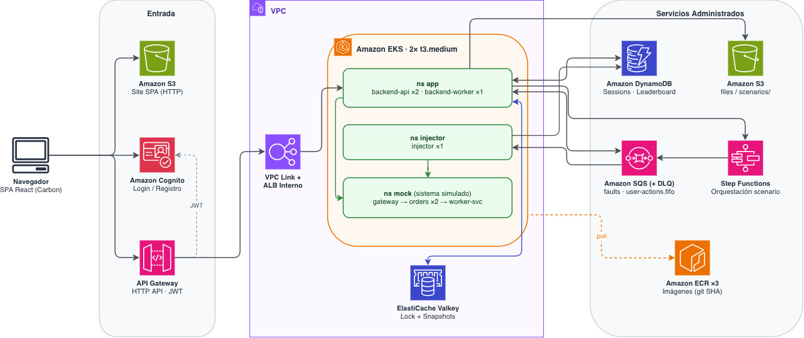

# On-Call Training

**Practice handling a production incident before you're the one on call.**

On-Call Training is a web app where students and junior SDE/SREs work through a realistic outage. A small distributed system runs in Kubernetes on AWS. When you start a scenario, a real fault is injected into it: a deployment is scaled to zero, pods are deleted. You diagnose it from a live dashboard (service health, pods, logs, events) and fix it with predefined actions. The system detects the recovery on its own, scores you on time to detect, time to resolve and wrong moves, and keeps your history, charts and a per-scenario leaderboard.

This repo, **`oncall-training-infra`**, holds the infrastructure and orchestration: Terraform for every AWS resource, the Kubernetes manifests, the Step Functions state machine, and the two services that make the incident real (the **injector** and the **mock system**). The app lives in two sibling repos:

| Repo | Contains |
|---|---|
| **[oncall-training-infra](https://github.com/Pardosito/oncall-training-infra)** (this one) | Terraform, Kubernetes manifests, Step Functions, injector, mock system, `make` targets for the whole lifecycle |
| [oncall-training-backend](https://github.com/Pardosito/oncall-training-backend) | API + worker (Node/TypeScript), scenarios (JSON), `openapi.json` |
| [oncall-training-frontend](https://github.com/Pardosito/oncall-training-frontend) | React SPA (IBM Carbon) |

ITESO *Desarrollo en la Nube* course project, Fall 2026, team **Cafeinomanos**: Ian Rodríguez (infra and orchestration) and Juan Pablo González (backend and frontend).

## How it works



One incident, end to end:

1. **Start.** The user signs in with Cognito and starts a scenario. The request goes through **API Gateway**, which checks the token, then a VPC link and an internal ALB to the **API** pods in EKS. The API takes a lock in **ElastiCache** (one incident at a time), writes the session to **DynamoDB** and starts a **Step Functions** execution.
2. **Inject.** After a short warmup, the state machine sends a `FAULT` message to **SQS**. The **injector** consumes it and breaks the **mock system** (`gateway → orders → worker-svc`) through the Kubernetes API, for example by scaling `orders` to 0.
3. **Diagnose.** The backend **worker** rebuilds a dashboard snapshot every 2 s (replicas, pod status, latency, recent events) and caches it in ElastiCache. The SPA polls it. Upstream services degrade realistically: `gateway` reports `orders` as unreachable.
4. **Act.** The user acknowledges the incident, reads logs, and scales or restarts deployments. Actions go through a FIFO queue, so they apply in order for each session.
5. **Resolve.** When the system is healthy again, the worker completes the state machine's task token. Step Functions computes the score, stores it, and the worker restores the mock system to its baseline. If time runs out or the user abandons, the session ends as `FAILED` and the system is reset all the same.

### Scenarios

| Scenario | What the user sees | Notes |
|---|---|---|
| `orders-down` | Orders failing, storefront degraded | The introductory scenario |
| `checkout-failing` | Every service looks unhealthy | The real cause is `worker-svc`; fixing `orders` first counts as a wrong move |
| `storefront-down` | The entry point is down | A short warm-up |
| `peak-outage` | Checkout down during peak | Hard mode: no logs, 3 minutes, double time penalty, 100 points per wrong move |

Score = `base − TTD × perSecondTTD − TTR × perSecondTTR − wrongActions × perWrongAction`, with the weights set per scenario.

## Tech stack

**AWS services**

| Service | Used for |
|---|---|
| **EKS** (2× `t3.medium`, managed node group) | Runs the backend (`app`), the injector (`injector`) and the mock system (`mock`) in separate namespaces, isolated with RBAC and NetworkPolicies (VPC CNI) |
| **API Gateway** (HTTP API) | Fixed HTTPS URL for the API, Cognito JWT authorizer, CORS, throttling; VPC link to an internal ALB |
| **Step Functions** (Standard, JSONata) | Runs each scenario: `InjectFault → WaitForFix` (task token) `→ PersistResolved / MarkFailed → NotifyEnded` |
| **SQS** | `faults` (standard) and `user-actions.fifo`, each with a DLQ |
| **DynamoDB** | `Sessions` table plus a `Leaderboard` GSI; history, stats and rankings are queried from here |
| **ElastiCache** (Valkey, TLS) | Dashboard snapshots, the active-session lock, recent events |
| **Cognito** | User pool with managed login (Carbon-styled), self sign-up with email verification |
| **S3** | SPA hosting (website endpoint), scenario files and per-session event logs, Terraform state |
| **ECR** | Images tagged with git SHAs (immutable) |
| **ALB** + AWS Load Balancer Controller | Internal ALB owned by Terraform; pods registered through a `TargetGroupBinding` |

**Code and tooling**

- **Terraform** ≥ 1.10 (AWS provider 6.x, `awscc` for S3), split into a cheap, always-on `foundation` stack and an expensive, disposable `cluster` stack
- **Kubernetes** manifests with **Kustomize** (base plus `aws` and `local` overlays)
- **TypeScript / Node 22** for every service: injector, mock system, backend (Express, AWS SDK v3) and frontend (React, Vite, IBM Carbon, TanStack Query)
- **kind** + **LocalStack** for local runs, **Calico** to enforce NetworkPolicies locally
- **GitHub Actions** for CI (fmt/validate, tflint, kubeconform, checkov, lint, tests, image builds); one **Makefile** drives the whole lifecycle
- **mise** pins every CLI version (`mise.toml`)

## Running it

### Prerequisites

- An **AWS Academy Learner Lab** (us-east-1; no IAM resources can be created)
- **[mise](https://mise.jdx.dev)** for the pinned CLIs, **Docker** (image builds, kind), and **[GitHub CLI](https://cli.github.com)** logged in with access to the three repos

```bash
brew install mise                 # or: curl https://mise.run | sh
echo 'eval "$(mise activate zsh)"' >> ~/.zshrc            # terminal
echo 'eval "$(mise activate zsh --shims)"' >> ~/.zprofile  # IDEs / GUI git clients; then restart the shell
mise install                      # terraform, kubectl, helm, node, pnpm, awscli, kind, …
pre-commit install                # fmt, validate, shellcheck, trailing whitespace
```

If a commit fails with "Neither Terraform nor OpenTofu binary could be found", mise isn't active in that shell.

### First time on a lab account

```bash
make creds              # paste the Learner Lab "AWS CLI" block: writes ~/.aws/credentials, updates the repos' AWS_* secrets
make bootstrap          # Terraform state bucket (local state, once per account)
make foundation-apply   # S3, DynamoDB, SQS, ECR, Cognito, API Gateway, Step Functions (cents per day)
make images             # build and push the injector and mock-system images; prints their tags
```

Then:
- **Backend:** run the backend's **Release** workflow, which pushes its image and uploads the scenarios.
- **Frontend:** fill its `.env.aws.local` from `make foundation-output` (Cognito IDs, `VITE_API_BASE_URL`), then run `SITE_BUCKET=<site bucket> pnpm deploy:s3`.

### Every work session

```bash
make creds                          # lab credentials expire with each session
make cluster-up                     # VPC, EKS, nodes, ElastiCache, internal ALB, manifests (~20 min)
make deploy BACKEND_TAG=<sha>       # roll out images; current tags are in k8s/overlays/aws/images.env
make status                         # nodes, pods, API URL, ALB target health, cost reminder
```

Open the site URL (`terraform -chdir=terraform/foundation output site_url`), create an account and start a scenario.

> [!WARNING]
> **Run `make cluster-down` before you stop working** (about 10 min). EKS, the nodes, the ALB and ElastiCache bill about **$0.25/h (≈ $6/day)** until they're destroyed, and the lab doesn't stop them for you. Run it even if `cluster-up` failed halfway. Foundation (data, users, images, the API's URL) stays up and survives cluster teardowns and lab restarts.

### Without AWS

| Goal | Command |
|---|---|
| Frontend only, simulated backend in the browser | `pnpm dev:mocks` (frontend repo) |
| Backend with an in-memory store and a simulated injector | `pnpm dev:memory` (backend repo) |
| Mock system + injector on a local cluster | `make kind-up` (`CALICO=1` enforces NetworkPolicies), then `make local-smoke` or `make netpol-test` |
| Every CI check | `make lint` |

### Common commands

| Command | Does |
|---|---|
| `make creds` | Load Learner Lab credentials locally and into the GitHub secrets |
| `make foundation-plan` / `make foundation-apply` | Plan / apply the always-on stack |
| `make cluster-up` / `make cluster-down` | Create / destroy the hourly-billed stack |
| `make deploy BACKEND_TAG=… [INJECTOR_TAG=…] [MOCK_TAG=…]` | Roll out images and wait for the rollout |
| `make status` | Cluster health at a glance |
| `make users USERS_FILE=f` / `make e2e-user` | Invite users / create the e2e test user |
| `make check-rbac` | Verify every service account can do exactly what it should |
| `make diagram` | Re-render `docs/solucion.png` from `docs/solucion.mmd` |

## Changes from the original design

| Change | Why | Decision |
|---|---|---|
| **API Gateway added** (HTTP API) in front of an internal ALB | The ALB's URL changed with every `cluster-up` and the ALB was exposed to the internet | [D-33](docs/DECISIONS.md#d-33--api-gateway-http-api-in-front-of-an-internal-alb) |
| **No CloudFront**: the SPA is served from the S3 website endpoint | The Learner Lab doesn't allow CloudFront | [D-31](docs/DECISIONS.md#d-31--s3-website-instead-of-cloudfront) |
| **No Glue or Athena**: stats and leaderboards come straight from DynamoDB | The lab role can't use Glue or Athena | [D-37](docs/DECISIONS.md#d-37--glue-and-athena-dropped) |

Compared with the course's suggested structure, the backend runs as a container on **EKS** instead of a standalone EC2 instance, the API is reached through **API Gateway** ([docs/api.md](docs/api.md)), and every resource is created with **Terraform** instead of boto3 scripts, so the whole stack can be recreated with one command. No keys, passwords, ARNs or account IDs are in the code: lab credentials are loaded with `make creds` and per-account values come from Terraform outputs.

## Limitations

Most of these come from the AWS Academy Learner Lab, not from design choices. Each one is tracked in [DECISIONS.md](docs/DECISIONS.md#3-current-limitations) with its mitigation.

- **No IAM of our own.** Every pod and service runs as the lab's `LabRole`, so there's no per-workload least privilege (IRSA, Pod Identity). Namespaces, RBAC and NetworkPolicies are the isolation boundary.
- **No CloudFront, custom domain or certificate.** The SPA is served over **plain HTTP** from the S3 website endpoint. That also disables PKCE, and the sign-in code reaches the SPA unencrypted. The API itself is HTTPS at a fixed URL.
- **No Glue or Athena.** The lab role can't use them, so stats and leaderboards are computed with DynamoDB queries instead of SQL over S3.
- **One incident at a time.** All sessions share one mock system, so a global lock admits a single active incident. Others see a countdown until it's free.
- **One fault per scenario.** Only the scenario's first fault is injected; combined failures aren't supported yet.
- **Cost and startup time.** The cluster takes ~20 min to come up and must be torn down after each session. Credentials expire with every lab session.
- **No high availability or observability stack.** There's a single ElastiCache node, worker and injector, and no Prometheus or Grafana. Debugging uses `kubectl logs`, `make status` and the Step Functions console.
- **Not production networking.** Nodes run in public subnets without NAT, behind tight security groups, with no SSH and IMDSv2 required.

**Future work** with a real AWS account: IRSA and a GitHub OIDC deploy role; CloudFront with a custom domain and TLS; private subnets with VPC endpoints; one mock namespace per session so incidents can run concurrently; richer faults (latency, CPU, network partitions) with Chaos Mesh; Athena over the session event logs; Prometheus and Grafana; a nightly auto cluster-down. See [DECISIONS.md › Future improvements](docs/DECISIONS.md#4-future-improvements).

## Repository layout

```
terraform/
  bootstrap/        state bucket (local state, run once per account)
  foundation/       always on: S3, DynamoDB, Cognito, API Gateway, ECR, SQS, Step Functions
  cluster/          ephemeral: VPC, EKS, node group, add-ons, LB controller, internal ALB, ElastiCache
  modules/          small reusable modules (queue with DLQ)
statemachines/      scenario.asl.json (JSONata), rendered by Terraform
k8s/
  base/             namespaces, RBAC, NetworkPolicies, backend, injector, mock system
  overlays/aws/     ECR images, TargetGroupBinding, config rendered from Terraform outputs
  overlays/local/   kind: local images, LocalStack endpoints
services/
  injector/         consumes `faults`, breaks the mock system (TypeScript)
  mock-system/      one image, ROLE = gateway | orders | worker-svc (TypeScript)
scripts/            credentials, config rendering, deploy, status, kind, smoke tests
docs/               architecture, conventions, decisions, API, data model, diagram
```

## Documentation

| Read | For |
|---|---|
| [AGENTS.md](AGENTS.md) | Scope, Learner Lab constraints, stack, commands, rules for contributors |
| [docs/ARCHITECTURE.md](docs/ARCHITECTURE.md) | Every AWS resource, the cluster layout, the state machine, the message contracts, cost, and the operations runbooks (§13) |
| [docs/DECISIONS.md](docs/DECISIONS.md) | Every decision and why, known limitations, future improvements |
| [docs/CONVENTIONS.md](docs/CONVENTIONS.md) | How Terraform, manifests, services, scripts and workflows are written |
| [docs/BACKLOG.md](docs/BACKLOG.md) · [docs/planning/](docs/planning/README.md) | Issues by milestone, roadmap and changelog |

### Course deliverables

The ITESO course deliverables (some written in Spanish, as the course requires):

| # | Deliverable | Where |
|---|---|---|
| 1 | Solution diagram | [docs/solucion.jpg](docs/solucion.jpg) (detailed: [docs/solucion.png](docs/solucion.png), source [docs/solucion.mmd](docs/solucion.mmd)) |
| 2 | Data model | [docs/modelo-datos.md](docs/modelo-datos.md) |
| 3 | API design | [docs/api.md](docs/api.md) |
| 4 | Source code | Backend and its `Dockerfile`: [oncall-training-backend](https://github.com/Pardosito/oncall-training-backend). Infrastructure and services: [`terraform/`](terraform), [`k8s/`](k8s), [`services/`](services) (with their `Dockerfile`s), [`scripts/`](scripts) |
| 5 | Deployment evidence | [docs/evidencias/](docs/evidencias/README.md) |
| 6 | Pending work | [docs/pendientes.md](docs/pendientes.md) |
