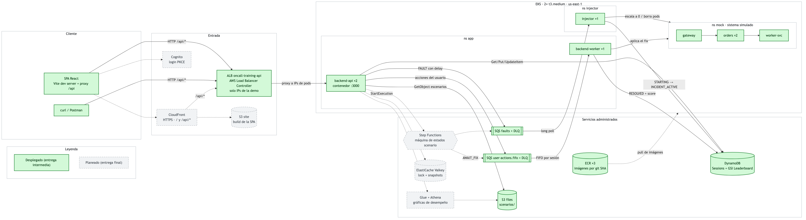

# oncall-training-infra

Infrastructure for **On-Call Training**, a web app where students and junior SDE/SREs practice handling a production incident: a mock distributed system runs in EKS, a fault is injected, and the user diagnoses and fixes it from a live dashboard.

This repo holds:
- **Terraform** for every AWS resource, in three stacks: `bootstrap` (state bucket), `foundation` (cheap, always on) and `cluster` (EKS and everything billed hourly)
- **Kubernetes manifests** (Kustomize) for all workloads, including the backend's
- the **injector** and the **mock system**, two small TypeScript services
- the `make` targets that build images, bring the cluster up and down, and roll out releases
- *(planned)* the **Step Functions** state machine that drives a scenario, and the GitHub workflows

The app itself lives in [`oncall-training-backend`](https://github.com/Pardosito/oncall-training-backend) and [`oncall-training-frontend`](https://github.com/Pardosito/oncall-training-frontend).

## Entrega intermedia · Desarrollo en la Nube (ITESO, Otoño 2026)

**Proyecto:** On-Call Training · **Equipo:** Cafeinomanos

| Integrante | Rol |
|---|---|
| Ian Rodríguez | Infraestructura y orquestación (este repo) |
| Juan Pablo González | Backend y frontend |

### Caso de uso de punta a punta

Un usuario inicia el escenario `orders-down`. El backend guarda la sesión en DynamoDB y manda una falla a SQS. El injector apaga el servicio `orders` del sistema simulado en EKS. El usuario ve el incidente en el dashboard, escala `orders` de vuelta y el worker detecta la recuperación, calcula el puntaje y marca la sesión `RESOLVED`.



Verde: desplegado hoy. Gris punteado: planeado para la entrega final. Fuente editable en [`docs/solucion.mmd`](docs/solucion.mmd) (`make diagram`).

### Repositorios

| Repo | Contiene |
|---|---|
| [oncall-training-infra](https://github.com/Pardosito/oncall-training-infra) (este) | Terraform, manifiestos de Kubernetes, injector y mock system |
| [oncall-training-backend](https://github.com/Pardosito/oncall-training-backend) | API + worker (Node/TypeScript), su `Dockerfile`, escenarios y `openapi.json` |
| [oncall-training-frontend](https://github.com/Pardosito/oncall-training-frontend) | SPA en React que consume la API |

### Entregables

| # | Entregable | Dónde |
|---|---|---|
| 1 | Diagrama de la solución | [docs/solucion.png](docs/solucion.png) |
| 2 | Modelo de datos | [docs/modelo-datos.md](docs/modelo-datos.md) |
| 3 | Diseño de la API | [docs/api.md](docs/api.md) |
| 4 | Código fuente | Backend + `Dockerfile`: [oncall-training-backend](https://github.com/Pardosito/oncall-training-backend) (`src/`, `Dockerfile`). Infraestructura y servicios: [`terraform/`](terraform), [`k8s/`](k8s), [`services/`](services) (con sus `Dockerfile`), [`scripts/`](scripts) |
| 5 | Evidencia de despliegue | [docs/evidencias/](docs/evidencias/README.md) |
| 6 | Pendientes | [docs/pendientes.md](docs/pendientes.md) |

**Diferencias con la estructura sugerida.** El backend corre como contenedor, pero en **EKS** en lugar de una EC2 suelta, y la API entra por un **ALB** en lugar de API Gateway ([DECISIONS D-28](docs/DECISIONS.md#d-28--no-api-gateway), [api.md](docs/api.md#por-qué-alb-y-no-api-gateway)). Los recursos se crean con **Terraform** en lugar de scripts boto3, así que todo se puede volver a crear con un comando. Ninguna llave, contraseña, ARN ni id de cuenta está en el código: las credenciales del lab se cargan con `make creds` y los valores de cada cuenta salen de los outputs de Terraform.

### Cómo correrlo

| Situación | Comandos | Tiempo |
|---|---|---|
| Cuenta nueva del lab (una vez) | `make creds` → `make bootstrap` → `make foundation-apply` → `make images` | una vez |
| Cada sesión del lab / después de un reinicio | `make creds` → `make cluster-up` → `make deploy BACKEND_TAG=<sha>` → `make status` | ~20 min |
| Al terminar | `make cluster-down` (el cluster cuesta ≈ $0.25/h) | ~10 min |
| Sin AWS | backend: `pnpm dev:memory` en su repo (API + worker + injector simulado) | 1 min |

Los datos (DynamoDB, S3) y las imágenes (ECR) viven en el stack `foundation`, que no se destruye, así que sobreviven a `make cluster-down` y a los reinicios del contenedor. Detalle en [Lab session routine](#lab-session-routine).

### Documentación de planeación

Roadmap por área y bitácora del proyecto: [resumen](docs/planning/README.md) · [infra](docs/planning/infra-plan.md) · [backend](docs/planning/back-plan.md) · [frontend](docs/planning/front-plan.md) · [changelog](docs/planning/changelog.md).

## Docs

| Read | For |
|---|---|
| [AGENTS.md](AGENTS.md) | Start here: scope, Learner Lab constraints, stack, commands, repo layout, rules |
| [docs/ARCHITECTURE.md](docs/ARCHITECTURE.md) | Every AWS resource, the cluster layout, contracts, operations |
| [docs/CONVENTIONS.md](docs/CONVENTIONS.md) | How Terraform, manifests, services, scripts and workflows are written |
| [docs/DECISIONS.md](docs/DECISIONS.md) | What we decided and why, known limitations, future work |
| [docs/BACKLOG.md](docs/BACKLOG.md) | Every issue, by milestone |

## Prerequisites

- An **AWS Academy Learner Lab** session (us-east-1 only; no IAM resources can be created)
- **[mise](https://mise.jdx.dev)**, which installs every other CLI at the pinned version (see [Tooling](#tooling))
- **Docker**, for building images and running kind
- **[GitHub CLI](https://cli.github.com)** (`gh`), logged in with access to the infra, backend and frontend repos, so `make creds` can update their secrets

## Tooling

All CLI versions are pinned in [`mise.toml`](mise.toml): terraform, tflint, kubectl, kustomize, kubeconform, kind, helm, node 22, pnpm, shellcheck, awscli v2 and pre-commit.

```bash
brew install mise                 # or: curl https://mise.run | sh
echo 'eval "$(mise activate zsh)"' >> ~/.zshrc            # terminal
echo 'eval "$(mise activate zsh --shims)"' >> ~/.zprofile  # IDEs / GUI git clients; then restart the shell
mise install                      # installs every pinned tool for this repo
mise ls --current                 # check what's active
pre-commit install                # git hooks: fmt, validate, shellcheck, trailing whitespace
```

Inside the repo, mise puts the pinned versions first on your `PATH`. The pre-commit hooks need this too: if a commit fails with "Neither Terraform nor OpenTofu binary could be found", mise isn't activated in that shell.

## Lab session routine

Lab credentials expire at the end of every session, and the cluster stack costs about **$0.25/h (≈ $6/day)** while it's up. So every session goes like this:

1. **Start the lab** and check the remaining budget.
2. **`make creds`** and paste the "AWS CLI" block. This writes `~/.aws/credentials` and updates the `AWS_*` GitHub secrets in all three repos.
3. **`make cluster-up`** only if you need EKS today (about 20 min). For most work, use kind instead: `make kind-up`.
4. Work.
5. **`make cluster-down`.**

> [!WARNING]
> **Always run `make cluster-down` before you stop working.** The lab doesn't stop the cluster for you: EKS, the nodes, the ALB and ElastiCache keep billing until they're destroyed, and a forgotten cluster can drain the lab budget. Run it even if `cluster-up` failed halfway. `foundation` (data, users, images) stays up and costs cents per day.

First time in a new lab account, run `make bootstrap` once (after `make creds`) to create the Terraform state bucket.

### Recovering the bootstrap state

The `bootstrap` stack keeps its state locally (`terraform/bootstrap/terraform.tfstate`, gitignored), because it creates the bucket every other stack stores its state in. If that file is lost (new laptop, fresh clone), the bucket is still there, so **don't** run `make bootstrap` again: it would try to create a bucket that already exists. Import it instead:

```bash
cd terraform/bootstrap
terraform init
BUCKET="oncall-training-tfstate-$(aws sts get-caller-identity --query Account --output text)"
terraform import awscc_s3_bucket.state "$BUCKET"
terraform plan   # should say "No changes"
cd ../.. && make backend-config   # rewrite foundation/ and cluster/ backend.hcl
```

### Switching to a new lab account

Everything is per account: the state bucket, the foundation resources and the images. After `make creds` with a different account:

```bash
make bootstrap           # moves the old local state to terraform/bootstrap/archive/<old account>/,
                         # creates this account's state bucket and rewrites both backend.hcl
make foundation-apply    # files bucket, Sessions, queues, ECR (empty)
make images              # the injector and mock-system images don't carry over
```

Then run the backend's Release workflow so its image and scenarios exist in the new account. If `backend.hcl` still points at another account's bucket, every foundation/cluster target stops with a message saying so.

## First time on a lab account (after `make bootstrap`)

```bash
make foundation-apply          # S3, DynamoDB, SQS, ECR (cheap, stays up)
make foundation-output         # share the queue URLs, table and ECR URLs with the team
cp terraform/cluster/terraform.tfvars.example terraform/cluster/cluster.auto.tfvars
# edit alb_ingress_cidrs: your and your teammate's public IP (curl -s https://checkip.amazonaws.com)
make images                    # needs Docker; builds linux/amd64 and pushes with the git SHA tag
```

## Demo: inject a fault by hand

```bash
make cluster-up                # ~20 min; then:
make deploy MOCK_TAG=<sha> INJECTOR_TAG=<sha>   # the tags printed by make images
make check-rbac                # every line "ok"
kubectl -n mock port-forward svc/gateway 8080:8080 &
curl -s localhost:8080/health  # {"status":"up",...}

# Send a FAULT by hand (ARCHITECTURE §7). The injector only applies faults for a session in
# STARTING, so create a throwaway session item first.
aws dynamodb put-item --table-name Sessions --item \
  '{"user_id":{"S":"demo"},"session_id":{"S":"demo"},"state":{"S":"STARTING"}}'
QUEUE=$(terraform -chdir=terraform/foundation output -raw faults_queue_url)
aws sqs send-message --queue-url "$QUEUE" --message-body \
  '{"faultId":"demo-1","sessionId":"demo","userId":"demo","type":"SCALE_TO_ZERO","target":{"namespace":"mock","deployment":"orders"}}'

kubectl -n mock get deploy orders          # 0/0
curl -s localhost:8080/health              # 503 {"status":"down","reason":"ECONNREFUSED ..."}
kubectl -n injector logs deploy/injector   # "scaled to zero"
kubectl -n mock logs deploy/gateway        # "GET /orders failed: ..."

kubectl -n mock scale deploy/orders --replicas=2   # the fix
curl -s localhost:8080/health              # up again
aws dynamodb delete-item --table-name Sessions --key '{"user_id":{"S":"demo"},"session_id":{"S":"demo"}}'

make cluster-down              # always
```
