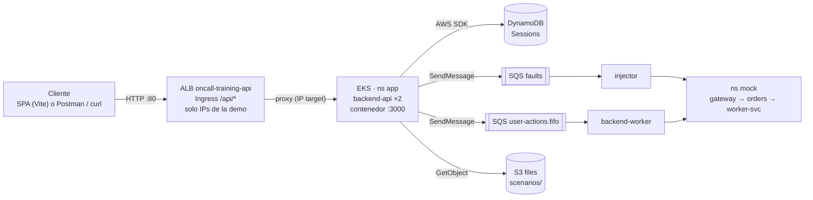

# Diseño de la API

Entregable 3 de la entrega intermedia. El contrato completo es el [`openapi.json` del backend](https://github.com/Pardosito/oncall-training-backend/blob/main/openapi/openapi.json) (se sirve también en `GET /api/openapi.json`).

> [!IMPORTANT]
> **Nuestra entrada no es API Gateway.** El backend corre en **EKS** (no en una EC2 suelta) y la API se expone con un **Application Load Balancer** que crea el AWS Load Balancer Controller desde un `Ingress` de Kubernetes. El ALB cumple el papel de API Gateway en la guía: recibe el request, lo pasa tal cual (equivalente a *HTTP proxy*) a los pods del backend y regresa la respuesta. Ver [DECISIONS D-28](DECISIONS.md#d-28--no-api-gateway) y la sección [¿Por qué ALB y no API Gateway?](#por-qué-alb-y-no-api-gateway).

## Flujo de un request



La respuesta regresa por el mismo camino hasta el cliente. Las acciones del usuario son asíncronas: la API responde **202** y el worker las aplica en orden (FIFO por sesión).

## Stage y URL de invocación

| | Valor |
|---|---|
| Entorno | `lab` (un solo entorno; equivale al stage `dev` de la guía) |
| URL base | `http://<alb-dns>/api` donde `<alb-dns>` = `oncall-training-api-<id>.us-east-1.elb.amazonaws.com` |
| Cómo obtenerla | `make status` o `kubectl -n app get ingress backend-api -o jsonpath='{.status.loadBalancer.ingress[0].hostname}'` |

> [!NOTE]
> El DNS del ALB cambia cada vez que se recrea el cluster (Learner Lab), así que la URL de la demo se muestra en vivo con `make status`. Por eso no está fija en el código: la SPA la recibe en `API_PROXY_TARGET` y los scripts buscan el balanceador por su nombre fijo, `oncall-training-api`.

## Recursos

El `Ingress` publica solo dos rutas: el prefijo `/api` y `/healthz` (el health check del ALB). `/readyz` queda interno, para la readiness probe de Kubernetes.

**Integración:** proxy. El ALB reenvía método, ruta, headers, query string y cuerpo sin transformar; toda la validación (zod) vive en el backend, que es la única fuente del contrato (`openapi.json`). No hay mapping templates.

**Autenticación en la entrega intermedia:** `AUTH_MODE=dev`, cada request manda `x-dev-user: <id>[:<nombre>]`. Cognito con `Authorization: Bearer <token>` es **planeado** para la final.

| Recurso | Método | Integración | Destino | Request | Response esperada | Estado |
|---|---|---|---|---|---|---|
| `/healthz` | GET | proxy | `backend-api` GET `/healthz` | — | 200 `{status:"ok"}` | desplegado |
| `/api/scenarios` | GET | proxy | `backend-api` GET `/api/scenarios` | — | 200 lista de `ScenarioSummary` | desplegado |
| `/api/scenarios/{scenarioId}` | GET | proxy | `backend-api` GET `/api/scenarios/{scenarioId}` | id en la ruta | 200 `ScenarioPublic`; 404 si no existe | desplegado |
| `/api/sessions` | POST | proxy | `backend-api` POST `/api/sessions` | `{ "scenarioId": "orders-down" }` | 201 `{ sessionId }`; 400 cuerpo inválido; 404 escenario; 409 `SESSION_BUSY` | desplegado |
| `/api/sessions/{sessionId}` | GET | proxy | `backend-api` GET `/api/sessions/{sessionId}` | id en la ruta | 200 `SessionView`; 404 si no existe o es de otro usuario | desplegado |
| `/api/sessions/{sessionId}/dashboard` | GET | proxy | `backend-api` GET `…/dashboard` | id en la ruta | 200 `DashboardSnapshot` (réplicas, salud, eventos, acciones disponibles) | desplegado |
| `/api/sessions/{sessionId}/actions` | POST | proxy | `backend-api` POST `…/actions` → SQS `user-actions.fifo` | `{ type, target?, params? }` | 202 `{ actionId }`; 400; 409 `SESSION_NOT_ACTIVE`; 422 `ACTION_NOT_ALLOWED` | desplegado |
| `/api/sessions/{sessionId}/logs?service=` | GET | proxy | `backend-api` GET `…/logs` → logs del pod en ns `mock` | `service` en el query | 200 `{ service, lines[] }`; 409; 422 | desplegado |
| `/api/sessions/{sessionId}/abandon` | POST | proxy | `backend-api` POST `…/abandon` | — | 202; 404; 409 | desplegado |
| `/api/me/sessions` | GET | proxy | `backend-api` | `limit`, `cursor` | 200 `{ items, nextCursor? }` | planeado |
| `/api/me/stats/{queryName}` | GET | proxy | `backend-api` → Athena | `score-over-time` \| `ttd-ttr-by-attempt` | 200 `{ rows }`; 504 timeout de Athena | planeado |
| `/api/leaderboard/{scenarioId}` | GET | proxy | `backend-api` → GSI `Leaderboard` | id en la ruta | 200 top 10 | planeado |

### Requests mal formados

Todos los errores tienen el mismo cuerpo, con un `requestId` que también llega en el header `x-request-id`:

```json
{ "error": { "code": "VALIDATION_ERROR", "message": "…", "details": { "issues": [] }, "requestId": "01J…" } }
```

| Caso | Respuesta | Dónde se valida |
|---|---|---|
| JSON inválido | 400 `MALFORMED_JSON` | backend, middleware de Express |
| Falta un campo o tiene otro tipo | 400 `VALIDATION_ERROR` | backend, esquema zod de la ruta |
| Cuerpo > 100 kB / sin `Content-Type: application/json` | 413 / 415 | backend |
| Sin `x-dev-user` (o token) | 401 `UNAUTHORIZED` | backend, middleware de auth |
| Ruta que no existe | 404 `NOT_FOUND` | backend |

## Pruebas (curl)

```bash
API=http://<alb-dns>/api
U='x-dev-user: demo:demo'

# GET: escenarios disponibles
curl -s "$API/scenarios" -H "$U"

# POST: iniciar una sesión (manda la falla con delay de warmupSeconds)
curl -s -X POST "$API/sessions" -H "$U" -H 'Content-Type: application/json' \
  -d '{"scenarioId":"orders-down"}'
# → {"sessionId":"01J…"}
SID=<sessionId>

# GET: estado y dashboard (la SPA lo consulta cada 2 s)
curl -s "$API/sessions/$SID" -H "$U"
curl -s "$API/sessions/$SID/dashboard" -H "$U"

# POST: acciones del usuario
curl -s -X POST "$API/sessions/$SID/actions" -H "$U" -H 'Content-Type: application/json' -d '{"type":"ACKNOWLEDGE"}'
curl -s "$API/sessions/$SID/logs?service=gateway" -H "$U"
curl -s -X POST "$API/sessions/$SID/actions" -H "$U" -H 'Content-Type: application/json' \
  -d '{"type":"SCALE_DEPLOYMENT","target":"orders","params":{"replicas":2}}'

# Error: cuerpo inválido → 400 VALIDATION_ERROR
curl -s -X POST "$API/sessions" -H "$U" -H 'Content-Type: application/json' -d '{}'
```

### Respuestas reales

Salida de los comandos de arriba contra el backend real (commit `bafa7e6` de `oncall-training-backend`) corriendo con `pnpm dev:memory`, el mismo código que corre en EKS con almacenamiento en memoria y el injector simulado. Las capturas de la misma corrida contra el ALB están en [evidencias](evidencias/README.md).

| Request | Status | Respuesta |
|---|---|---|
| `GET /scenarios` | 200 | `[{"id":"orders-down","title":"Orders service is not responding","description":"Checkout requests are failing with 5xx.","maxResolveSeconds":600}]` |
| `GET /scenarios/orders-down` | 200 | `{"id":"orders-down", …, "warmupSeconds":20, "maxResolveSeconds":600, "targets":["gateway","orders","worker-svc"], "availableActions":["ACKNOWLEDGE","VIEW_LOGS","RESTART_DEPLOYMENT","SCALE_DEPLOYMENT"], "scoring":{"base":1000,"perSecondTTD":1,"perSecondTTR":1,"perWrongAction":25}}` |
| `POST /sessions` | 201 | `{"sessionId":"01M6QGHEZNKHMHEGJTPVCBM192"}` |
| `GET /sessions/{id}` (antes de la falla) | 200 | `{"sessionId":"01M6QG…","scenarioId":"orders-down","state":"STARTING","createdAt":"2026-11-06T04:05:47.637Z","wrongActions":0,"actionsCount":0}` |
| `POST /sessions` (otra vez) | 409 | `{"error":{"code":"SESSION_BUSY","message":"A scenario is already running.","details":{"retryAfterSeconds":729},"requestId":"01M6QGHSS6…"}}` |
| `GET /sessions/{id}/dashboard` | 200 | `{"state":"INCIDENT_ACTIVE","elapsedSeconds":12,"services":[{"name":"gateway","desiredReplicas":1,"readyReplicas":1,"health":"down",…},{"name":"orders","desiredReplicas":0,"readyReplicas":0,"health":"down","pods":[]},{"name":"worker-svc",…,"health":"healthy"}],"recentEvents":[{"type":"FAULT_INJECTED","summary":"Incident started"},{"type":"SESSION_STARTED",…}],…}` |
| `POST /sessions/{id}/actions` `ACKNOWLEDGE` | 202 | `{"actionId":"01M6QGJFBP2CKGH4F725KMVA0K"}` |
| `GET /sessions/{id}/logs?service=gateway` | 200 | `{"service":"gateway","lines":["level=error service=gateway msg=\"upstream unavailable\" status=503"]}` |
| `POST /sessions/{id}/actions` `SCALE_DEPLOYMENT` orders → 2 | 202 | `{"actionId":"01M6QGJFCJ0RZVJGYY72M44P5N"}` |
| `GET /sessions/{id}` (después del fix) | 200 | `{"state":"RESOLVED","faultInjectedAt":"…04:06:07.897Z","acknowledgedAt":"…04:06:20.790Z","endedAt":"…04:06:23.900Z","score":971,"ttdSeconds":13,"ttrSeconds":16,"wrongActions":0,"actionsCount":2}` |

Errores:

| Request | Status | Respuesta |
|---|---|---|
| `POST /sessions` con `{}` | 400 | `{"error":{"code":"VALIDATION_ERROR","message":"Request validation failed.","details":{"issues":[{"path":"scenarioId","message":"Invalid input: expected string, received undefined"}]},"requestId":"…"}}` |
| `POST /sessions` con `{bad` | 400 | `{"error":{"code":"MALFORMED_JSON","message":"Request body is not valid JSON.","requestId":"…"}}` |
| `POST /sessions` con `{"scenarioId":"nope"}` | 404 | `{"error":{"code":"NOT_FOUND","message":"Scenario not found.","requestId":"…"}}` |
| `GET /sessions/<id que no existe>` | 404 | `{"error":{"code":"NOT_FOUND","message":"Session not found.","requestId":"…"}}` |
| `POST …/actions` con `{"type":"DELETE_EVERYTHING"}` | 400 | `{"error":{"code":"VALIDATION_ERROR",…,"details":{"issues":[{"path":"type","message":"Invalid discriminator value. Expected 'ACKNOWLEDGE' \| 'RESTART_DEPLOYMENT' \| 'SCALE_DEPLOYMENT'"}]}}}` |
| `GET /scenarios` sin `x-dev-user` | 401 | `{"error":{"code":"UNAUTHORIZED","message":"Send x-dev-user: <id>[:<username>] (dev auth).","requestId":"…"}}` |

## ¿Por qué ALB y no API Gateway?

| | ALB + Ingress (elegido) | API Gateway |
|---|---|---|
| Cómo llega a los pods | Directo a las IPs de los pods (`target-type: ip`); el controller actualiza los targets cuando Kubernetes reprograma pods | Necesita un ALB o NLB interno igual, más un VPC Link |
| Infraestructura como código | Lo declara el `Ingress` en `k8s/overlays/aws`, junto con el resto de los manifiestos | Recursos aparte en Terraform que hay que mantener en sincronía con el cluster |
| Validación y contrato | En el backend con zod, fuente única en `openapi.json` | Se duplicaría en modelos de API Gateway |
| Costo | ≈ $0.025/h, solo mientras el cluster está arriba | Por request, más el balanceador que de todos modos hace falta |
| Desventaja | Sin throttling, API keys ni stages integrados; HTTP en la entrega intermedia | — |

En la final, CloudFront se pone delante (`/api/*` → ALB) para tener HTTPS y una sola URL con el sitio (ver [pendientes](pendientes.md)).
