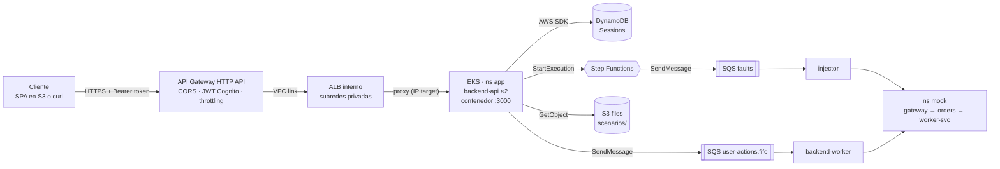

# Diseño de la API

Entregable 3 de la entrega intermedia. El contrato completo es el [`openapi.json` del backend](https://github.com/Pardosito/oncall-training-backend/blob/main/openapi/openapi.json) (se sirve también en `GET /api/openapi.json`).

> [!IMPORTANT]
> **Actualización (2026-11-26): la entrada ahora es API Gateway.** En la entrega intermedia la API entraba por un ALB público. Ahora un **API Gateway HTTP API** recibe el request (HTTPS, CORS, valida el token de Cognito y aplica throttling) y lo pasa por un **VPC link** a un **ALB interno** que reenvía a los pods del backend en EKS ([DECISIONS D-33](DECISIONS.md#d-33--api-gateway-http-api-in-front-of-an-internal-alb)). No hay CloudFront porque el Learner Lab no lo permite (D-31), y las estadísticas salen de DynamoDB porque el rol del lab no puede usar Glue ni Athena (D-37).

## Flujo de un request



La respuesta regresa por el mismo camino hasta el cliente. Las acciones del usuario son asíncronas: la API responde **202** y el worker las aplica en orden (FIFO por sesión).

## Stage y URL de invocación

| | Valor |
|---|---|
| Stage | `$default` (un solo entorno, `lab`), con auto-deploy |
| URL base | `https://<api-id>.execute-api.us-east-1.amazonaws.com/api` |
| Cómo obtenerla | `terraform -chdir=terraform/foundation output -raw api_url` o `make status` |
| Throttling | 20 requests/s, ráfagas de 40 (variables `api_throttle_rate` / `api_throttle_burst`) |

> [!NOTE]
> La API vive en el stack `foundation`, así que su URL no cambia cuando se destruye y se recrea el cluster. Mientras el cluster está apagado, las rutas no existen y la API responde 404.

## Recursos

API Gateway publica una ruta por método (`GET|POST|PUT|PATCH|DELETE /api/{proxy+}`, con el token de Cognito) y `GET /healthz` sin token. No hay ruta `OPTIONS`: API Gateway contesta los preflight de CORS. `/readyz` queda interno, para la readiness probe de Kubernetes.

**Integración:** HTTP proxy por VPC link al listener del ALB interno. Se reenvía método, ruta, headers, query string y cuerpo sin transformar; toda la validación (zod) vive en el backend, que es la única fuente del contrato (`openapi.json`). No hay mapping templates.

**Autenticación:** `Authorization: Bearer <access token de Cognito>`. API Gateway rechaza con 401 un token ausente, vencido o de otro cliente, y el backend lo vuelve a validar. (En la entrega intermedia era `AUTH_MODE=dev` con el header `x-dev-user`.)

| Recurso | Método | Integración | Destino | Request | Response esperada | Estado |
|---|---|---|---|---|---|---|
| `/healthz` | GET | proxy | `backend-api` GET `/healthz` | — | 200 `{status:"ok"}` | desplegado |
| `/api/scenarios` | GET | proxy | `backend-api` GET `/api/scenarios` | — | 200 lista de `ScenarioSummary` | desplegado |
| `/api/scenarios/{scenarioId}` | GET | proxy | `backend-api` GET `/api/scenarios/{scenarioId}` | id en la ruta | 200 `ScenarioPublic`; 404 si no existe | desplegado |
| `/api/sessions` | POST | proxy | `backend-api` POST `/api/sessions` | `{ "scenarioId": "orders-down" }` | 201 `{ sessionId }`; 400 cuerpo inválido; 404 escenario; 409 `SESSION_BUSY` | desplegado |
| `/api/sessions/{sessionId}` | GET | proxy | `backend-api` GET `/api/sessions/{sessionId}` | id en la ruta | 200 `SessionView`; 404 si no existe o es de otro usuario | desplegado |
| `/api/sessions/{sessionId}/dashboard` | GET | proxy | `backend-api` GET `…/dashboard` | id en la ruta | 200 `DashboardSnapshot` (réplicas, salud, eventos, acciones disponibles) | desplegado |
| `/api/sessions/{sessionId}/actions` | POST | proxy | `backend-api` POST `…/actions` → SQS `user-actions.fifo` | `{ type, target?, params? }` | 202 `{ actionId }`; 400; 409 `SESSION_NOT_ACTIVE`; 422 `ACTION_NOT_ALLOWED` | desplegado |
| `/api/sessions/{sessionId}/logs?service=` | GET | proxy | `backend-api` GET `…/logs` → logs del pod en ns `mock` | `service` en el query | 200 `{ service, lines[] }`; 409; 422 | desplegado |
| `/api/sessions/{sessionId}/abandon` | POST | proxy | `backend-api` POST `…/abandon` | — | 202; 404; 409 | desplegado |
| `/api/me/sessions` | GET | proxy | `backend-api` → DynamoDB | `limit`, `cursor` | 200 `{ items, nextCursor? }` | desplegado |
| `/api/me/stats/{queryName}` | GET | proxy | `backend-api` → DynamoDB (sin Athena, D-37) | `score-over-time` \| `ttd-ttr-by-attempt` | 200 `{ rows }` | desplegado |
| `/api/leaderboard/{scenarioId}` | GET | proxy | `backend-api` → GSI `Leaderboard` | id en la ruta | 200 top 10 | desplegado |

### Requests mal formados

Todos los errores tienen el mismo cuerpo, con un `requestId` que también llega en el header `x-request-id`:

```json
{ "error": { "code": "VALIDATION_ERROR", "message": "…", "details": { "issues": [] }, "requestId": "01J…" } }
```

| Caso | Respuesta | Dónde se valida |
|---|---|---|
| JSON inválido | 400 `MALFORMED_JSON` | backend, middleware de Express |
| Falta un campo o tiene otro tipo | 400 `VALIDATION_ERROR` | backend, esquema zod de la ruta |
| Cuerpo > 100 kB / sin `Content-Type: application/json` | 413 / 415 | backend |
| Sin token o token inválido | 401 | API Gateway (authorizer JWT), y otra vez el backend |
| Más de 20 requests/s | 429 | API Gateway (throttling) |
| Ruta que no existe | 404 `NOT_FOUND` | backend |

## Pruebas (curl)

```bash
API=$(terraform -chdir=terraform/foundation output -raw api_url)/api
U="Authorization: Bearer $TOKEN"   # access token de Cognito

# GET: escenarios disponibles
curl -s "$API/scenarios" -H "$U"

# POST: iniciar una sesión (manda la falla con delay de warmupSeconds)
curl -s -X POST "$API/sessions" -H "$U" -H 'Content-Type: application/json' \
  -d '{"scenarioId":"orders-down"}'
# → {"sessionId":"01J…"}
SID=<sessionId>

# GET: estado y dashboard (la SPA lo consulta cada 2 s)
curl -s "$API/sessions/$SID" -H "$U"
curl -s "$API/sessions/$SID/dashboard" -H "$U"

# POST: acciones del usuario
curl -s -X POST "$API/sessions/$SID/actions" -H "$U" -H 'Content-Type: application/json' -d '{"type":"ACKNOWLEDGE"}'
curl -s "$API/sessions/$SID/logs?service=gateway" -H "$U"
curl -s -X POST "$API/sessions/$SID/actions" -H "$U" -H 'Content-Type: application/json' \
  -d '{"type":"SCALE_DEPLOYMENT","target":"orders","params":{"replicas":2}}'

# Error: cuerpo inválido → 400 VALIDATION_ERROR
curl -s -X POST "$API/sessions" -H "$U" -H 'Content-Type: application/json' -d '{}'
```

### Respuestas reales

Salida de la entrega intermedia (con `x-dev-user`, contra el ALB público de entonces), el 2026-11-06 a las 04:56 UTC (backend `2688b14`). La salida completa está en [`evidencias/curl-pruebas.txt`](evidencias/curl-pruebas.txt).

| Request | Status | Respuesta |
|---|---|---|
| `GET /scenarios` | 200 | `[{"id":"orders-down","title":"Orders service is not responding","description":"Checkout requests are failing with 5xx.","maxResolveSeconds":600}]` |
| `GET /scenarios/orders-down` | 200 | `{"id":"orders-down", …, "warmupSeconds":20, "maxResolveSeconds":600, "targets":["gateway","orders","worker-svc"], "availableActions":["ACKNOWLEDGE","VIEW_LOGS","RESTART_DEPLOYMENT","SCALE_DEPLOYMENT"], "scoring":{"base":1000,"perSecondTTD":1,"perSecondTTR":1,"perWrongAction":25}}` |
| `POST /sessions` | 201 | `{"sessionId":"01M6QKEAA3HB61CPN555EX9A2X"}` |
| `GET /sessions/{id}` (antes de la falla) | 200 | `{"sessionId":"01M6QKEAA3…","scenarioId":"orders-down","state":"STARTING","createdAt":"2026-11-06T04:56:30.275Z","wrongActions":0,"actionsCount":0}` |
| `POST /sessions` (otra vez) | 409 | `{"error":{"code":"SESSION_BUSY","message":"A scenario is already running.","details":{"retryAfterSeconds":740},"requestId":"01M6QKEAP2…"}}` |
| `GET /sessions/{id}/dashboard` | 200 | `{"state":"INCIDENT_ACTIVE","elapsedSeconds":5,"services":[{"name":"gateway","desiredReplicas":1,"readyReplicas":1,"health":"down","latencyMs":811,"pods":[{"name":"gateway-657ccbcf67-kfrvx",…}]},{"name":"orders","desiredReplicas":0,"readyReplicas":0,"health":"down","pods":[]},{"name":"worker-svc",…,"health":"healthy","latencyMs":13}],"recentEvents":[{"type":"FAULT_INJECTED","summary":"Incident started"},{"type":"SESSION_STARTED",…}],…}` |
| `POST /sessions/{id}/actions` `ACKNOWLEDGE` | 202 | `{"actionId":"01M6QKF48X7PA6ZDSFJ8KRKBB4"}` |
| `GET /sessions/{id}/logs?service=gateway` | 200 | `{"service":"gateway","lines":["{\"level\":50,\"role\":\"gateway\",\"reason\":\"ECONNREFUSED orders:8080\",\"msg\":\"GET /orders failed: ECONNREFUSED orders:8080\"}", "{… \"msg\":\"GET /orders failed: timeout after 800ms\"}", …]}` |
| `POST /sessions/{id}/actions` `SCALE_DEPLOYMENT` orders → 2 | 202 | `{"actionId":"01M6QKF4QC0BPK5ZHA4PM0S1K7"}` |
| `GET /sessions/{id}` (después del fix) | 200 | `{"state":"RESOLVED","faultInjectedAt":"…04:56:50.374Z","acknowledgedAt":"…04:56:56.862Z","endedAt":"…04:57:02.323Z","score":982,"ttdSeconds":6,"ttrSeconds":12,"wrongActions":0,"actionsCount":2}` |

Errores:

| Request | Status | Respuesta |
|---|---|---|
| `POST /sessions` con `{}` | 400 | `{"error":{"code":"VALIDATION_ERROR","message":"Request validation failed.","details":{"issues":[{"path":"scenarioId","message":"Invalid input: expected string, received undefined"}]},"requestId":"…"}}` |
| `POST /sessions` con `{bad` | 400 | `{"error":{"code":"MALFORMED_JSON","message":"Request body is not valid JSON.","requestId":"…"}}` |
| `POST /sessions` con `{"scenarioId":"nope"}` | 404 | `{"error":{"code":"NOT_FOUND","message":"Scenario not found.","requestId":"…"}}` |
| `GET /sessions/<id que no existe>` | 404 | `{"error":{"code":"NOT_FOUND","message":"Session not found.","requestId":"…"}}` |
| `POST …/actions` con `{"type":"DELETE_EVERYTHING"}` | 400 | `{"error":{"code":"VALIDATION_ERROR",…,"details":{"issues":[{"path":"type","message":"Invalid discriminator value. Expected 'ACKNOWLEDGE' \| 'RESTART_DEPLOYMENT' \| 'SCALE_DEPLOYMENT'"}]}}}` |
| `GET /scenarios` sin `x-dev-user` | 401 | `{"error":{"code":"UNAUTHORIZED","message":"Send x-dev-user: <id>[:<username>] (dev auth).","requestId":"…"}}` |

## De ALB a API Gateway

En la entrega intermedia elegimos un ALB sin API Gateway (D-28): CloudFront iba a ser la entrada con HTTPS y el ALB solo enrutaba a los pods. Dos cosas cambiaron:

1. **CloudFront no está permitido en el Learner Lab** (D-31), así que no había HTTPS ni una URL fija para la API.
2. **El ALB público** cambiaba de DNS con cada `cluster-up` y estaba expuesto a internet (al principio limitado a las IPs de la demo).

Con **API Gateway HTTP API** (D-33) la URL es HTTPS y fija (vive en `foundation`), los tokens se validan antes de entrar a la VPC, hay throttling y CORS administrados, y el ALB pasa a ser **interno** (solo lo alcanza el VPC link). Terraform crea el ALB y el target group; el AWS Load Balancer Controller solo registra las IPs de los pods con un `TargetGroupBinding`, así que `make cluster-down` es un `terraform destroy` sin pasos manuales.

| | Antes (ALB público) | Ahora (API Gateway → ALB interno) |
|---|---|---|
| URL | `http://<alb-dns>`, cambia con cada cluster | `https://<api-id>.execute-api…`, fija |
| Autenticación | solo en el backend | JWT en API Gateway y en el backend |
| Throttling | ninguno | 20/s, ráfagas de 40 |
| Exposición del ALB | internet (o IPs de la demo) | interno, solo el VPC link |
| Costo extra | — | $1 por millón de requests; el VPC link es gratis |
