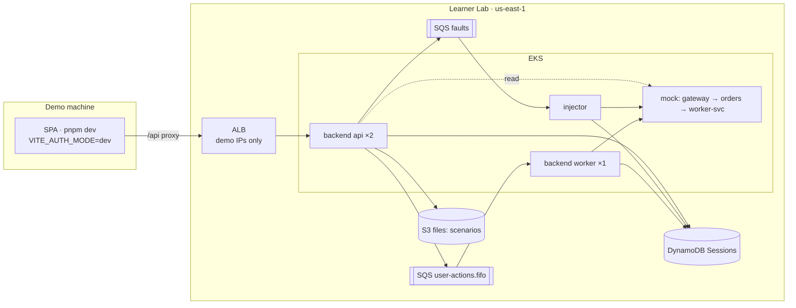
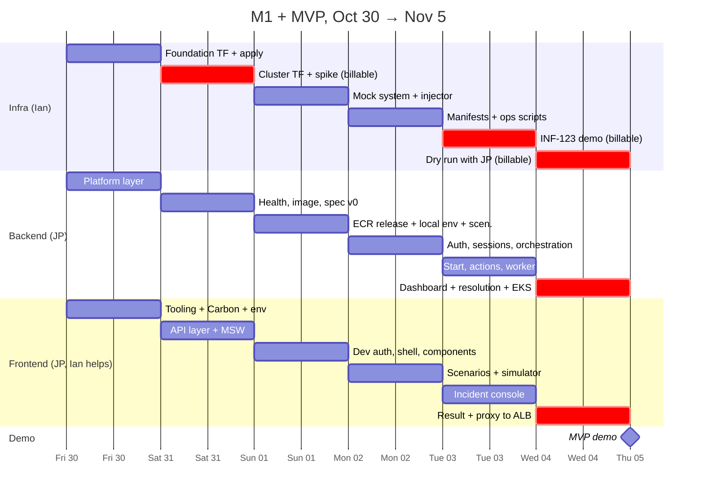

# On-Call Training (hub)

Start here. One plan to deliver **M1** and the **Nov 5 MVP** across the three repos, plus where each area's plan and decisions live. Written Fri Oct 30.

ITESO cloud course, team Cafeinomanos: **Ian** (infra, orchestration) and **JP** (backend, frontend).

## Notes in this folder

| Area | Plan | Decisions | Repo |
|---|---|---|---|
| **Infra** | [Infra plan (M1 + MVP)](infra-plan.md) | [Infra decisions](../DECISIONS.md) | `oncall-training-infra` (Ian) |
| **Back** | [Back plan (M1 + MVP)](back-plan.md) | [Back decisions](https://github.com/Pardosito/oncall-training-backend/blob/main/docs/DECISIONS.md) | `oncall-training-backend` (JP) |
| **Front** | [Front plan (M1 + MVP)](front-plan.md) | [Front decisions](https://github.com/Pardosito/oncall-training-frontend/blob/main/docs/DECISIONS.md) | `oncall-training-frontend` (JP) |
| All | this note | [Changelog](changelog.md): what changed and when | |

---

## 1. Where we stand (Fri Oct 30, from GitHub)

| Repo | M0 | M1 (due Oct 29) | MVP (due Nov 5) | Code today |
|---|---|---|---|---|
| Infra | 15/15 ✅ | 0/50 | 0/8 | Tooling, `make creds`, `make bootstrap`, state bucket |
| Backend | 11/11 ✅ | 0/22 | 0/45 | Tooling + CI; empty module skeleton |
| Frontend | — | 0/61 | 0/22 | Docs only |
| **Total** | | **0/133** | **0/75** | |

> [!CAUTION]
> **The Oct 29 deliverable was missed in all three repos**
> 208 open issues for 6 days. The plans below don't change the scope. They set an order, pull a few issues forward, and propose about 24 deferrals to the week of Nov 9.

---

## 2. The MVP in one picture

No Step Functions, ElastiCache, Cognito or CloudFront until Nov 19 (infra D-25, backend D-24, frontend D-18).

---

## 3. Joint timeline

---

## 4. Handoffs between repos

Most of the risk is in what one repo has to give another. Each handoff has a date and an owner.

| # | When | From → To | What | Unblocks |
|---|---|---|---|---|
| H1 | **Fri Oct 30** | Infra → Back | Foundation outputs: table name, queue URLs, ECR URL, files bucket | BE-029, BE-128, BE-084, local config |
| H2 | **Sat Oct 31** | Back → Front | `openapi.json` spec v0 (contract-first, backend P-01) | FE-019 → ~20 frontend issues |
| H3 | **Sat Oct 31** | Back → Infra | BE-030 deployment contract: image, commands, ports, probes, env, replicas | Infra #82–#83 manifests (Mon) |
| H4 | **Sun Nov 1** | Back → Infra | First image tag in ECR (even if only `/healthz`) | INF-123 on Tue, `make deploy` |
| H5 | **Tue Nov 3** | Infra ↔ Back | FAULT message check: `faultId, sessionId, userId, type, target, sentAt` (infra §7) | Injector record step (#99) → `INCIDENT_ACTIVE` |
| H6 | **Tue Nov 3** | Back | Scenarios uploaded to S3 (`aws s3 sync scenarios/ …/scenarios/` after `make creds`) | Scenario list isn't empty |
| H7 | **Wed Nov 4** | Infra → Front | ALB DNS name; demo IPs in `alb_ingress_cidrs` | FE-125, FE-097 |
| H8 | **Wed Nov 4** | Back → Infra + Front | Final MVP image tag + spec | Dry run, frontend re-pin |

---

## 5. Cross-repo decisions for review

The per-area plans have their own lists. These need **both** of you:

| # | Proposal | Recommendation |
|---|---|---|
| X-1 | Workload split | Ian takes frontend FE-034 to FE-036 (simulator) and FE-125 after INF-123 on Tue (infra plan §10.8, front P-03) |
| X-2 | Defer ~24 issues to the week of Nov 9 | Frontend: Cognito, busy-409, landing, build safety, polish (front §5). Backend: #23 Redis client, #42 Cognito verifier, #28, #51 automation (back §5). Infra: none beyond D-25 |
| X-3 | Contract-first backend | Schemas and spec before handlers (back P-01), so the frontend and the injector work against the real contract |
| X-4 | Update GitHub milestones | Move the deferred issues and BE-034 (into MVP) once you both agree. M1 due dates are in the past; set M1 = Nov 5 too or close it into MVP |
| X-5 | Write back the Oct 22 cross-repo answers | Infra D-13/D-14/D-18/D-22 answered backend O-01/O-03/O-05 and frontend O-01/O-04 and accepted backend D-11–13 and frontend D-14. Those docs still say "Proposed"/open |
| X-6 | Billable sessions | Only three cluster sessions: Sat spike, Tue INF-123, Wed dry run, plus the demo. JP's image must be in ECR **before** each one starts |

---

## 6. Top risks

| Risk | Area | Mitigation |
|---|---|---|
| EKS or the LB controller fails with LabRole (O-01) | Infra | Sat spike; NLB fallback (infra D-07) |
| Backend + frontend workload | Back + Front | X-1, X-2 |
| Contract drift (FAULT shape, spec) | All | X-3, H5, shared fixtures |
| Cluster left up | Infra | `make cluster-down` after every session (~$6/day otherwise) |
| No real run before the demo | All | Wed dry run; plan B is `pnpm dev:mocks` showing the same screens |

---

## 7. How these notes are kept

- The repos' `docs/DECISIONS.md` are the official logs; these notes tell the story and track the plan.
- New decision → add it to the area's decisions note **and** a line to [Changelog](changelog.md).
- Plans are checklists: tick issues off as they close.
