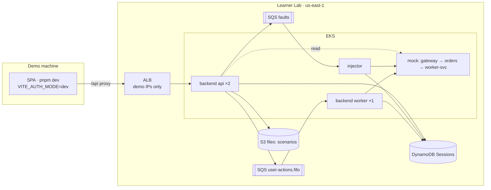

# On-Call Training: roadmap

How the project is delivered across its three repos: the milestones, what each area has built, what comes next and how the repos depend on each other.

ITESO cloud course, team Cafeinomanos: **Ian** (infra, orchestration) and **JP** (backend, frontend).

## Notes in this folder

| Area | Plan | Decisions | Repo |
|---|---|---|---|
| **Infra** | [Infra plan](infra-plan.md) | [Infra decisions](../DECISIONS.md) | `oncall-training-infra` (Ian) |
| **Back** | [Back plan](back-plan.md) | [Back decisions](https://github.com/Pardosito/oncall-training-backend/blob/main/docs/DECISIONS.md) | `oncall-training-backend` (JP) |
| **Front** | [Front plan](front-plan.md) | [Front decisions](https://github.com/Pardosito/oncall-training-frontend/blob/main/docs/DECISIONS.md) | `oncall-training-frontend` (JP) |
| All | this note | [Changelog](changelog.md): what changed and when | |

---

## 1. Milestones

| Milestone | Date | Goal | Status |
|---|---|---|---|
| M0 · Setup | Oct 27 | Repo tooling, lab credentials, Terraform state bucket | ✅ Done in all three repos |
| M1 · EKS up | Oct 29 → Nov 3 | Foundation + EKS; backend, mock system and injector in separate namespaces; the injector breaks the system and it can be revived | ✅ Done |
| **Intermediate delivery** | **Nov 5** | One incident loop end to end on AWS: start → fault → fix → resolved ([D-25](../DECISIONS.md)) | ✅ Done, in direct mode |
| M2 · Orchestration | Nov 19 | Step Functions, ElastiCache, Cognito, CloudFront + S3 site, NetworkPolicies, CI | Next |
| M3 · Data + e2e | Nov 26 | Glue/Athena for the charts, history and leaderboard; e2e happy path on the deployed stack | Planned |
| M4 · Polish | after Nov 26 | Final docs, hardening | Planned |

---

## 2. The intermediate delivery in one picture

Step Functions, ElastiCache, Cognito and CloudFront join in M2 (infra D-25, backend D-24, frontend D-18). The contracts (FAULT message, session item, API shapes) stay the same, so M2 swaps implementations instead of rewriting them. The full picture, with deployed and planned parts, is [`solucion.png`](../solucion.png).

---

## 3. Contracts between repos

Most of the risk is in what one repo hands to another. These are the hand-offs the delivery depends on.

| # | From → To | What | Status |
|---|---|---|---|
| H1 | Infra → Back | Foundation outputs: table name, queue URLs, ECR URL, files bucket | ✅ |
| H2 | Back → Front | `openapi.json`, generated from the backend's schemas (contract-first); the frontend pins a backend commit | ✅ |
| H3 | Back → Infra | Deployment contract: image, commands, ports, probes, env, replicas | ✅ |
| H4 | Back → Infra | Backend image in ECR, tagged with the git SHA | ✅ (`2688b14`) |
| H5 | Infra ↔ Back | FAULT message: `faultId, sessionId, userId, type, target, sentAt` (infra ARCHITECTURE §7) | ✅ |
| H6 | Back | Scenarios uploaded to S3 by the backend's release workflow | ✅ |
| H7 | Infra → Front | ALB DNS name; demo IPs in `alb_ingress_cidrs` | ✅ per demo |
| H8 | Infra ↔ Back | Step Functions input/output and the `AWAIT_FIX` / `SESSION_ENDED` messages (ARCHITECTURE §6–7) | M2 |
| H9 | Infra → Front | CloudFront domain and Cognito client for the SPA build | M2 |

---

## 4. Top risks for the final delivery

| Risk | Area | Mitigation |
|---|---|---|
| Step Functions, ElastiCache or CloudFront hit a Learner Lab restriction | Infra | Small applies early, probe with the CLI (like D-24); direct mode keeps working as a fallback |
| One person owns backend and frontend | Back + Front | Contract-first API; Ian takes self-contained frontend pieces when needed |
| Contract drift (FAULT shape, spec, state machine I/O) | All | Shared JSON fixtures; the frontend pins a backend commit |
| Cluster left up | Infra | `make cluster-down` after every session (~$6/day otherwise) |

---

## 5. How these notes are kept

- The repos' `docs/DECISIONS.md` are the official logs; these notes give the overview and track the plan.
- New decision → add it to the area's decisions file **and** a line to the [Changelog](changelog.md).
