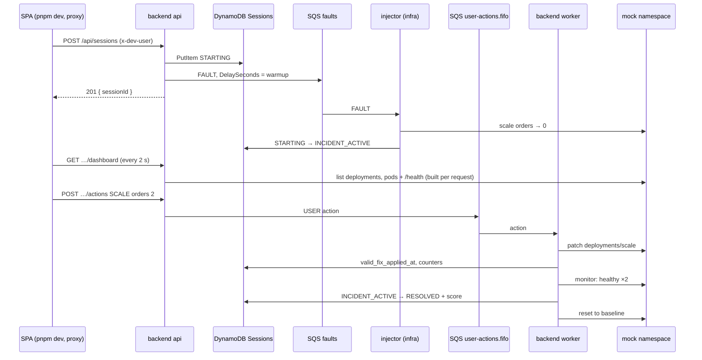
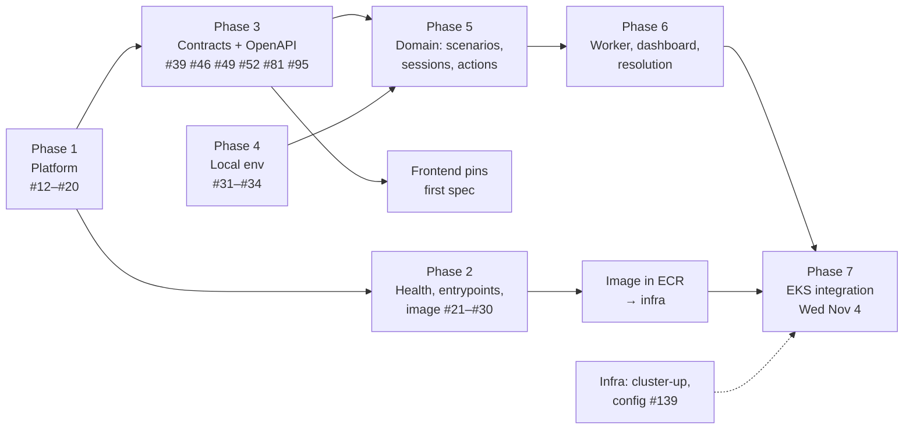

# M1 + MVP implementation plan (backend)

Plan for milestone **M1 · Deployable** (22 issues) and **MVP · Nov 5** (45 issues) in `oncall-training-backend`, so the **Nov 5 MVP** loop works on EKS. Written Fri Oct 30 for review. Owner: JP.

Related: [Back decisions](https://github.com/Pardosito/oncall-training-backend/blob/main/docs/DECISIONS.md) · [On-Call Training](README.md) (hub) · [Infra plan (M1 + MVP)](infra-plan.md) · [Front plan (M1 + MVP)](front-plan.md)

> [!WARNING]
> **Where we stand (Fri Oct 30)**
> - **M0 is done** (11/11 closed): pnpm + ESM + Node 22, strict tsconfig, ESLint type-checked, Prettier, Vitest unit/integration projects, CI (lint, format, typecheck, test), templates, README. AGENTS/CLAUDE/README stay at the root.
> - **M1: 0 of 22 done.** `src/` is the skeleton only: `createApp()` returns `{}`, `api.ts` prints a line, every module is an empty `index.ts`.
> - **MVP: 0 of 45 done.**
> - **The Oct 29 deliverable (API + worker in EKS) was missed.** Infra needs the image in ECR (BE-027 + BE-029) and the deployment contract (BE-030) before its Mon Nov 2 manifest work.
> - **The frontend is blocked on the spec.** FE-019 needs `openapi/openapi.json`, which only exists after BE-039.

---

## 1. What the MVP needs from this repo

One loop on EKS, with dev auth, no Redis and no Step Functions (D-24):

---

## 2. Critical path

**Two things leave this repo early and unblock the others:** the image in ECR (infra) and the first `openapi.json` (frontend). Both are scheduled before the domain work.

---

## 3. Day-by-day schedule

| Day | Work | Hands off |
|---|---|---|
| **Fri Oct 30** | Phase 1: #12, #13, #14, #15, #16, #17, #18, #19, #20 (pure code + unit tests) | — |
| **Sat Oct 31** | Phase 2: #21, #22, #24, #25, #26, #27, #28. Phase 3: #39 + the schema issues #46, #49, #52, #81, #95 → `pnpm openapi`. **#30 deployment contract to Ian** | **Spec v0 to frontend; contract to infra** |
| **Sun Nov 1** | #29 release workflow → **first image in ECR** (needs infra #24 and fresh lab secrets). Phase 4: #31, #32, #33, #34 (pulled in). Scenarios: #47, #48, #50 | **Image tag to infra** |
| **Mon Nov 2** | Auth: #42, #43, #127. Sessions: #53, #54, #55, #56, #57, #58. Orchestration: #61, #128. Mock cluster: #74, #75, #76, #78, #79, #80 | — |
| **Tue Nov 3** | #66, #67, #68 (start + get). Actions: #82, #83, #84, #85. Worker: #88, #90, #91 | Image to infra for INF-123 if ready |
| **Wed Nov 4** | Dashboard + resolution: #96, #98, #99, #100, #101, #103, #129, #130. **EKS dry run with infra** (`make deploy` of the new tag). #51 | Final MVP tag |
| **Thu Nov 5** | Fixes only. **MVP demo**. | — |

> [!IMPORTANT]
> **Wednesday is the integration day**
> Infra plans one cluster session on Wed Nov 4 for the dry run (Infra plan §2). The image tag has to be in ECR **before** that session starts, so the cluster isn't billing while the backend builds.

---

## 4. Phases

### Phase 1: platform (Fri, ~5 h, no AWS)

| Issue | What to build | Notes |
|---|---|---|
| **#12** env schema | zod schema for every var in ARCHITECTURE §9, frozen `Config`, error lists every failing var | Include the MVP vars from day one: `ORCHESTRATION_MODE`, `FAULTS_QUEUE_URL`, `ALLOW_DEV_AUTH`, optional `REDIS_URL`. **`ATHENA_*`, `COGNITO_*` and `STATE_MACHINE_ARN` must be optional in the MVP** (required only by mode: Cognito auth, Step Functions orchestration, Athena stats). Infra's `render-config` skips them, so a strict schema would crash the api on EKS (P-09) |
| **#13** refuse dev auth | throws when `AUTH_MODE=dev` and `NODE_ENV !== development` | #127 adds the `ALLOW_DEV_AUTH` escape hatch; write both in one go if convenient |
| **#14** pino + redaction | redact `authorization`, `cookie`, `taskToken` | `pino-pretty` dev dependency only |
| **#15** `AppError` | helpers `notFound`, `conflict`, `unprocessable`, `unavailable`, `gatewayTimeout` | |
| **#16** Clock | `systemClock`, `createFixedClock().advance()` | Used by scoring and timeout tests |
| **#17–#20** HTTP stack | request id → pino-http → json 100 kb → health → auth → routers → 404 → error handler; `trust proxy 2`; **no CORS** | MVP chain is Vite proxy → ALB → pod, still 2 hops, so `trust proxy 2` holds |

### Phase 2: health, entrypoints, image (Sat–Sun)

| Issue | What to build | Notes |
|---|---|---|
| **#21** `/healthz` | 200 `{status:"ok"}` | The ALB target group checks this path (infra #86) |
| **#22** AWS clients | DynamoDB doc client, S3, SQS, SFN, Athena; endpoint only with `AWS_ENDPOINT_URL`; **no `credentials`** | In EKS the node's LabRole is picked up through IMDS (hop limit 2, infra D-05) |
| **#23** Redis client | ioredis from `REDIS_URL`, `rediss://` → TLS | **Deferred to M2** (P-10): the MVP has no Redis, so building it now only to disable it under #129 is wasted work |
| **#24** `/readyz` | DynamoDB `DescribeTable`, S3 `HeadBucket` in parallel | No Redis check in the MVP; M2 adds it together with #23 (P-10) |
| **#25 / #26** entrypoints | api: graceful shutdown; worker: health on `:3001`, root `AbortController` | |
| **#27** Dockerfile | `deps` → `build` → `runtime` on `node:22-alpine`, `USER node` | **Must run with a read-only root FS** (infra CONVENTIONS §2 sets `readOnlyRootFilesystem`) |
| **#28** CI docker build | `docker build` on PR | Cheap; keep |
| **#29** release workflow | `workflow_dispatch`, lab creds from secrets, tag = git SHA, never `latest` | ECR repo is **IMMUTABLE** (infra #24), so a SHA can be pushed only once. GitHub runners are amd64, matching the x86_64 nodes. Never push a laptop-built image from an ARM Mac without `--platform linux/amd64` |
| **#30** deployment contract | Image name/tag scheme, commands, ports, probe paths, env vars, replicas (api 2, worker 1), RBAC | **Send by Sat Oct 31**; infra writes the manifests Mon Nov 2. Also record O-03 as answered (infra D-18) |

### Phase 3: contracts + first spec (Sat, ~3 h)

Pull the **schema-only** issues forward so the frontend gets a real spec:

| Issue | Schema |
|---|---|
| **#39** | OpenAPI registry + `pnpm openapi` |
| **#46**, **#49** | `Scenario`, `ScenarioSummary`, `ScenarioPublic` |
| **#52** | `SessionView`, state enum, `StartSessionRequest/Response` |
| **#81** | Action request + `user-actions` message |
| **#95** | `DashboardSnapshot` (incl. `stale`) |

Register the routes from ARCHITECTURE §6 with their schemas even before handlers exist, then commit `openapi/openapi.json`. The frontend pins that commit in `BACKEND_REF` (FE-019).

### Phase 4: local environment (Sun)

| Issue | What to build | Notes |
|---|---|---|
| **#31** compose | LocalStack (`dynamodb,s3,sqs`) + Redis | Step Functions isn't needed until M2 |
| **#32** table init | `Sessions` + GSI `Leaderboard` | Names must match infra #20 exactly |
| **#33** bucket init | files bucket + upload `scenarios/` | |
| **#34** queues init *(pulled from M2)* | `faults` + `user-actions.fifo` | **The MVP loop uses both queues**, so local dev needs them now (decision P-02) |

### Phase 5: domain (Sun–Tue)

| Area | Issues | Notes |
|---|---|---|
| Scenarios | #47 orders-down, #48 S3 loader + cache, #50 routes, #51 S3 sync in release | Until #51 runs, sync by hand after `make creds`: `aws s3 sync scenarios/ s3://oncall-training-files-<acct>/scenarios/`. **Without it #48 finds no scenarios and the frontend list is empty** |
| Auth | #42 Cognito verifier, #43 `x-dev-user`, #127 `ALLOW_DEV_AUTH` | #42 is MVP-tagged but Cognito only exists in M2. Write it with a local JWKS test, keep it small; **dev mode is what the demo uses** |
| Sessions | #53 transitions, #54 mapping, #55 create, #56 get, #57 conditional transition, #58 worker updates, #66 `startSession`, #67 `POST`, #68 `GET` | `startSession` in MVP: no lock (#129) → put item → `orchestration.start` → 201 |
| Orchestration | #61 interface + fake, #128 direct mode | `start` sends the **infra §7 FAULT shape** (`faultId, sessionId, userId, type, target, sentAt`) with `DelaySeconds = min(warmup, 900)`. Share a zod schema + JSON fixture with infra #96 (decision P-05). `userId` and `sessionId` are required: the injector's record step (infra #99, D-12) uses them. **Check this at the Tue Nov 3 cluster session**, before the Wed dry run |
| Mock cluster | #74 interface, #75 fake, #76 list, #78 scale/restart, #79 health checks, #80 selector | Scale needs `application/merge-patch+json` set explicitly with `@kubernetes/client-node` (same gotcha as infra #97) |
| Actions | #82 validation, #83 `isValidFix`, #84 SQS producer, #85 `POST …/actions` | FIFO: `MessageGroupId = sessionId`, dedup = `actionId` |

### Phase 6: worker, dashboard, resolution (Tue–Wed)

| Issue | What to build | MVP note |
|---|---|---|
| **#88** consumer loop | long poll, delete after success, abort on SIGTERM | Idempotency (#89) is M2 because it needs Redis |
| **#90 / #91** handlers | ACKNOWLEDGE; SCALE / RESTART | |
| **#96** snapshot builder | pure: deployments + pods + health → `DashboardSnapshot` | |
| **#98** scoring | TTD, TTR, score from scenario weights | Pure + unit tests |
| **#99** resolution detector | valid fix + healthy ×2 | Depends on #23 on paper; **in MVP keep the counter in worker memory** (single replica, D-08) behind an interface (decision P-03) |
| **#100** monitor loop | every 2 s | MVP: finds the active session with a scan (#129), runs the detector and the timeout check (#128); writes no snapshot |
| **#101** resolve | compute score → `orchestration.completeTask` | Direct mode writes `RESOLVED` and resets the baseline |
| **#103 / #130** dashboard route | built per request from the gateway when Redis is off | `recentEvents` from the session item timestamps. **The api now needs `MOCK_HEALTH_URL_TEMPLATE`** (ARCHITECTURE §9 says worker only). The shared `oncall-config` ConfigMap already provides it; update §9 (P-11) |
| **#129** no-Redis mode | optional `REDIS_URL`, no lock, readyz skip, scan for the active session | Record the scan choice in ARCHITECTURE |

### Phase 7: EKS integration (Wed Nov 4)

1. Release workflow → tag in ECR → tell Ian the SHA.
2. Ian refreshes lab secrets with `make creds` (this also updates the backend repo's secrets), then `make deploy` (updates `images.env`), `render-config` writes the MVP keys (infra #139).
3. `/readyz` green through the ALB.
4. Full loop from the SPA via the proxy; fix what breaks; tag the final image.

---

## 5. What's critical for Nov 5 and what can slip

Every M1 and MVP issue stays in its milestone. This is only the **order**: if time runs out, these are the ones that can land the week of Nov 9 without breaking the demo.

| Can slip past Nov 5 | Why it's safe |
|---|---|
| #42 Cognito verifier | Demo runs on dev auth; Cognito arrives in M2 |
| #51 scenario sync in CI | One manual `aws s3 cp` covers the MVP |
| #28 docker build in CI | The release workflow builds the image anyway |
| #23 Redis client | Deferred to M2 on purpose (P-10) |
| #31–#34 compose *(only if really late)* | Fallback: develop against the real foundation resources with lab creds and `MOCK_CLUSTER=fake` (decision P-06) |

---

## 6. Decisions for review

| # | Question | Recommendation |
|---|---|---|
| P-01 | The frontend needs types before the API exists | Contract-first: ship #39 + the schema issues on Sat and commit `openapi.json` before any handler |
| P-02 | Local MVP loop needs `faults` and `user-actions.fifo`, but queue init is BE-034 (M2) | Move #34 into the MVP milestone |
| P-03 | Resolution detector (#99) depends on Redis | In-memory counter behind an interface; the Redis implementation comes in M2 |
| P-04 | Locally with `MOCK_CLUSTER=fake`, nobody consumes `faults` (dev-inject is BE-105, M3) | Add a trimmed dev-inject (read `faults`, apply to the fake cluster, mark `INCIDENT_ACTIVE`) to the MVP, without the Step Functions parts |
| P-05 | Backend §8.1 `fault` and infra §7 `FAULT` differ (`sessionId`, `userId`, `sentAt`) | Infra §7 wins for the queue message; one JSON fixture copied into both repos' tests |
| P-06 | If compose slips | Use the real foundation (DynamoDB, SQS, S3 are always on and cheap) with lab creds; never in CI |
| P-07 | O-03: who rolls out images | Already answered by infra D-18: this repo pushes to ECR, infra runs `make deploy`. Record it in DECISIONS |
| P-09 | Strict config would crash the MVP api: `render-config` leaves out `ATHENA_*`, `COGNITO_*`, `STATE_MACHINE_ARN` | Make them conditional on `AUTH_MODE`, `ORCHESTRATION_MODE`, `STATS_MODE` in #12 |
| P-10 | Build the Redis client (#23) only to switch it off (#129)? | Defer #23 to M2; `/readyz` without Redis until then |
| P-11 | The per-request dashboard (#130) runs health checks from the api | The api reads `MOCK_HEALTH_URL_TEMPLATE` too; fix ARCHITECTURE §9 |
| P-08 | Doc drift: backend D-09 still says `dynamodb:updateItem.waitForTaskToken` | Infra D-13 replaced it with an `AWAIT_FIX` message on `user-actions`. Not MVP-blocking; fix the backend docs before M2 |

---

## 7. Risks

| Risk | Impact | Mitigation |
|---|---|---|
| One person owns backend **and** frontend: 67 + 83 issues in 6 days | Nothing finishes | Critical-path order above; split proposal in the [On-Call Training](README.md) hub |
| Image not in ECR before infra's Tue/Wed sessions | Cluster bills while waiting; INF-123 without backend | Image by Sun Nov 1 even if it only serves `/healthz` |
| FAULT shape mismatch with the injector | Session never leaves `STARTING` | Shared fixture (P-05); test on Tue with infra |
| ARM image on x86 nodes | `exec format error` | Only the release workflow pushes (amd64 runners) |
| Read-only root FS breaks the container | Pod crash loop | Test `docker run --read-only` in #27 |
| Lab creds expire before a release | Workflow fails | Ian's `make creds` pushes fresh secrets to all 3 repos |
