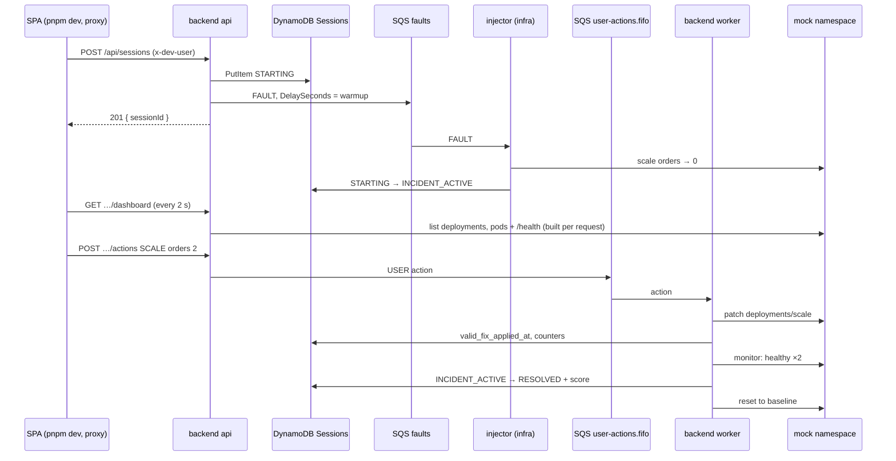

# Back plan

What `oncall-training-backend` has built and the plan for the final delivery. Owner: JP.

Related: [Back decisions](https://github.com/Pardosito/oncall-training-backend/blob/main/docs/DECISIONS.md) · [Roadmap](README.md) · [Infra plan](infra-plan.md) · [Front plan](front-plan.md)

---

## 1. The incident loop today (direct mode)

Dev auth, no Redis and no Step Functions (backend D-24):

---

## 2. Built for the intermediate delivery

| Area | What it is |
|---|---|
| Platform | zod config (variables required only by the active mode), pino with redaction, `AppError`, clock, Express stack (request id, JSON limit, auth, 404, error handler), `/healthz` and `/readyz` |
| Contracts | zod schemas for scenarios, sessions, actions and the dashboard; `openapi.json` generated from them and pinned by the frontend |
| Image | Multi-stage `Dockerfile` on `node:22-alpine`, `USER node`, runs with a read-only root FS; CI builds it; the release workflow pushes it to ECR tagged with the git SHA and syncs the scenarios to S3 |
| Domain | Scenario `orders-down` loaded from S3; sessions with conditional state transitions; actions validated and sent to `user-actions.fifo`; scoring (TTD, TTR, wrong actions) |
| Orchestration | Direct mode: the api sends the FAULT to `faults` with the warmup as delay |
| Worker | FIFO consumer, ACKNOWLEDGE / SCALE / RESTART handlers, resolution detector (valid fix + healthy twice), timeout check, reset to baseline |
| Local | `pnpm dev:memory` runs api + worker + a fake injector with no Docker; `pnpm dev:local` on LocalStack |

---

## 3. Plan for the final delivery

| Work | What to build | Milestone |
|---|---|---|
| Redis | ioredis client (`rediss://`), global session lock (replaces the active-session `Scan`), dashboard snapshots, idempotent action handling | M2 |
| Cognito | JWT verification against the user pool; dev auth only for local work | M2 |
| Step Functions | `ORCHESTRATION_MODE=stepfunctions`: `StartExecution`, store the `AWAIT_FIX` task token, `SendTaskSuccess` / `SendTaskFailure("Abandoned")`, clean up on `SESSION_ENDED` | M2 |
| History and stats | `GET /api/me/sessions`, `GET /api/leaderboard/{scenarioId}`, event logs to S3, Athena named queries for `GET /api/me/stats/{queryName}` | M3 |
| e2e | Happy path on the deployed stack | M3 |

---

## 4. Risks

| Risk | Impact | Mitigation |
|---|---|---|
| One person owns backend and frontend | Work piles up before each milestone | Contract-first API; self-contained pieces can move to Ian |
| FAULT or state machine contract drift with infra | Sessions stuck in `STARTING` | Shared JSON fixtures; check on EKS before each demo |
| ARM image on x86 nodes | `exec format error` | Only the release workflow (amd64 runners) pushes images |
| Lab credentials expire before a release | Workflow fails | `make creds` in the infra repo updates the secrets in all three repos |
