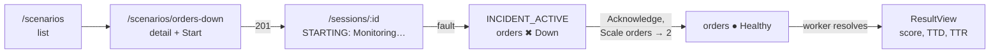
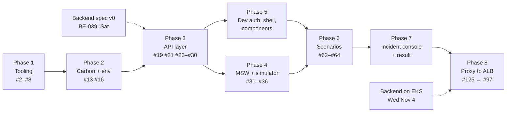

# M1 + MVP implementation plan (frontend)

Plan for milestone **M1 · Foundation** (61 issues) and **MVP · Nov 5** (22 issues) in `oncall-training-frontend`, so the SPA can drive the incident loop on EKS for the **Nov 5 MVP**. Written Fri Oct 30 for review. Owner: JP.

Related: [Front decisions](https://github.com/Pardosito/oncall-training-frontend/blob/main/docs/DECISIONS.md) · [On-Call Training](README.md) (hub) · [Back plan (M1 + MVP)](back-plan.md) · [Infra plan (M1 + MVP)](infra-plan.md)

> [!WARNING]
> **Where we stand (Fri Oct 30)**
> - **The repo only has docs.** No `package.json`, no code. 0 of 83 issues closed.
> - **The Oct 29 deliverable (shell, auth and scenarios against MSW) was missed.**
> - **FE-001 is half done, and wrong:** the Oct 25 commit moved *all* docs into `docs/`, including AGENTS, CLAUDE and README. Backend and infra both moved those three back to the root, because `docs/` breaks AGENTS links and Claude Code only loads `CLAUDE.md` from the root.
> - **No spec yet.** FE-019 needs the backend's `openapi.json` (BE-039), and the backend has 0 code.
> - **No Cognito until Nov 19**, and **no lock in the MVP** (backend D-24), so several M1 issues can't be tested against anything real before Nov 5.

---

## 1. What the MVP demo looks like

`API_PROXY_TARGET=http://<alb-dns> VITE_AUTH_MODE=dev pnpm dev` on a demo machine whose IP is in the ALB allow-list (infra #138):

Everything else (Cognito, busy notice, logs, abandon, history, stats) is built later or tested only against MSW.

---

## 2. Critical path

Phases 1–7 need **no backend and no AWS**: MSW and the session simulator stand in for both. Only Phase 8 needs the cluster.

---

## 3. Day-by-day schedule

| Day | Work | Depends on |
|---|---|---|
| **Fri Oct 30** | Fix FE-001 (AGENTS/CLAUDE/README back to root). Phase 1: #2, #3, #4, #5, #6, #7, #8, #10. Phase 2: #13, #14, #16 | — |
| **Sat Oct 31** | Phase 3 with the draft spec if the backend's isn't out yet: #19, #21, #23, #24, #28, #29, #30. Phase 4: #31, #32, #33 | Spec v0 (P-02) |
| **Sun Nov 1** | Phase 5: #41 (dev auth, decoupled from #40), #43, #44, #26 (dev header), #46, #47, #48, #52, #53, #54, #58, #59, #60, #61, #9 | — |
| **Mon Nov 2** | Phase 6: #62, #63, #64. Phase 4: #34, #35, #36 (simulator). Phase 7 start: #71, #72, #73, #74 | — |
| **Tue Nov 3** | Phase 7: #75, #76, #77, #78, #80, #81, #82, #83, #84, #85, #87 | — |
| **Wed Nov 4** | #92 ResultView, #94 happy-path test. Phase 8: #125, re-pin `BACKEND_REF` to the final backend, **#97 run against EKS** in infra's dry-run session | Backend tag in ECR; cluster up |
| **Thu Nov 5** | Fixes only. **MVP demo** | — |

---

## 4. Phases

### Phase 1: tooling (Fri)

| Issue | What to build | Notes |
|---|---|---|
| **#1** docs | Move AGENTS, CLAUDE, README back to the root; keep ARCHITECTURE, CONVENTIONS, DECISIONS, BACKLOG in `docs/` | Same fix as backend BE-001 and infra INF-001 (decision P-01) |
| **#2** scaffold | Vite + React + TS, pnpm | Pin `packageManager: pnpm@12.15.0` and Node 22 (`.nvmrc`), same as backend and infra's `mise.toml` (P-07) |
| **#3** tsconfig | `strict`, `noUncheckedIndexedAccess`, `verbatimModuleSyntax`, `@/` alias | |
| **#4** ignore + env example | `.gitignore`, `.env.example` with every `VITE_*` | Add `API_PROXY_TARGET` too (not a `VITE_*` var) |
| **#5 / #6** ESLint + Prettier | type-checked rules, `jsx-a11y`, `react-hooks` | Keep: the `fetch` ban (#23) relies on ESLint |
| **#7** dev proxy | `/api` → `http://localhost:3000` | #125 makes the target configurable; do both together |
| **#8** Vitest + RTL | jsdom, user-event | |
| **#10** CI | lint, typecheck, test, build | Cheap and protects the rush week |

### Phase 2: Carbon + config (Fri)

| Issue | What to build | Notes |
|---|---|---|
| **#13** Carbon g100 | `@carbon/react`, `sass-embedded`, `index.scss` | |
| **#14** Plex fonts | via Carbon | |
| **#16** env with zod | Cognito vars required only when `VITE_AUTH_MODE=cognito` | The MVP runs with `dev`, so nothing Cognito-related is required |

### Phase 3: API layer (Sat)

| Issue | What to build | Notes |
|---|---|---|
| **#19** pinned spec | `openapi/openapi.json` + `BACKEND_REF` | Backend publishes spec v0 on Sat (backend P-01). If it's late, use a **draft spec** written from backend ARCHITECTURE §6 with `BACKEND_REF=draft` (P-02) |
| **#21** types | `pnpm api:types` → `schema.d.ts` | |
| **#23** client | `createClient<paths>({ baseUrl: "" })`, ESLint ban on `fetch` outside `src/api/` | |
| **#24** `ApiError` | parse `{ error: { code, message, details, requestId } }` | |
| **#26** auth header | **dev branch only for now:** `x-dev-user` | The Bearer branch is written but only tested with a fake user until M2 |
| **#28** query keys · **#29** error copy · **#30** QueryClient defaults | | |

### Phase 4: mocks (Sat + Mon)

| Issue | What to build |
|---|---|
| **#31 / #32** | MSW in the browser (`pnpm dev:mocks`) and in Node for Vitest |
| **#33** | Scenario handlers |
| **#34** | Simulator: `STARTING` → 10 s → `INCIDENT_ACTIVE`, `orders` down; injectable time |
| **#35 / #36** | Start, session, dashboard, actions; recovery after ~4 s; score |

> [!TIP]
> **Ian could take Phase 4**
> The infra plan (§10, item 8) already suggests Ian takes #34–#36 and #125 after Tue. The simulator is self-contained and typed from the spec, so it doesn't need frontend context.

### Phase 5: dev auth, shell, shared components (Sun)

| Issue | What to build | Notes |
|---|---|---|
| **#41** dev auth | an authenticated `VITE_DEV_USER` without Cognito | **Decoupled from #40** (P-04). The auth layer exposes one interface; dev and Cognito implementations sit behind it |
| **#43** `RequireAuth` · **#44** `useCurrentUser` | | Work in dev mode; #44's display-name claim (O-02) only matters with Cognito |
| **#46** providers · **#47** router · **#48** header + nav | | Lazy routes, placeholder pages for history/stats/leaderboard |
| **#52** toasts · **#53** `PageHeader` · **#54** empty/error/loading | | Needed by every feature |
| **#58 / #59** formatters · **#60** `StatusIndicator` · **#61** `SessionStateTag` | | Pure, fast, unit-tested |
| **#9** `renderWithProviders` | | Needs #30 |

### Phase 6: scenarios (Mon)

#62 list, #63 detail, #64 start → navigate to `/sessions/:id`. The busy notice (#65–#67) waits, see §5.

### Phase 7: incident console + result (Mon–Wed)

| Issues | What |
|---|---|
| #71 helpers, #72 `useSession` (5 s), #73 `useDashboard` (2 s) | Polling stops at terminal state |
| #74 layout + console/result switch, #75 header, #76 timer, #77 "Monitoring…" | |
| #78 `ServiceTile`, #80 `EventTimeline` | Pod table (#79) is M2 |
| #81 enabled actions, #82 `useSendAction`, #83 Acknowledge, #84 Restart, #85 Scale, #87 error codes | No optimistic updates (D-08) |
| #92 `ResultView`, #94 happy-path test | |

### Phase 8: against EKS (Wed)

| Issue | What |
|---|---|
| **#125** | `API_PROXY_TARGET` (read only in `vite.config.ts`), `changeOrigin: true`, README demo steps |
| **#97** | Re-pin `BACKEND_REF` to the MVP backend tag, regenerate types, fix errors, full run against the API on EKS. Contract gaps become backend requests |

---

## 5. Deferred to after Nov 5 (proposed)

These are M1 issues that **can't be exercised against anything real before Nov 5**, or that add nothing to the demo. Proposal: move them to M2 (Nov 19) so the M1 milestone reflects what's actually needed (P-05).

| Issues | Why they can wait |
|---|---|
| **Cognito:** #40 OIDC config, #42 `/callback`, #27 401 renew, #45 Cognito sign-out, #49 user menu + sign out; Bearer branch of #26 | Cognito exists only from M2 (infra D-25). Built now, they'd be untested |
| **Busy 409:** #65 notice, #66 auto-retry, #67 test | The MVP has no lock (backend D-24), so 409 never happens. MSW could fake it, but it costs a day for no demo value |
| **Landing:** #56, #57 | With dev auth everyone is signed in; the demo starts at `/scenarios` |
| **Build safety + spec tooling:** #17 config error screen, #18 refuse dev auth in prod builds, #20 `api:sync`, #22 schema drift CI | No production build until the CloudFront deploy (M2). `api:sync` is a convenience; the spec can be copied by hand twice this week |
| **Polish:** #11 favicon/meta, #12 README *(except the #125 demo steps)*, #15 overrides file, #50 404, #51 `errorElement`, #55 document title | Small; do them the week of Nov 9 |

**Result:** 20 issues move out, so the Nov 5 critical path is about **63 issues** instead of 83.

---

## 6. Decisions for review

| # | Question | Recommendation |
|---|---|---|
| P-01 | FE-001 moved AGENTS/CLAUDE/README into `docs/` | Move them back to the root, as backend and infra did |
| P-02 | No backend spec before Sat at best | Pin backend spec v0; fallback is a draft spec from backend ARCHITECTURE §6, replaced at #97 |
| P-03 | Who builds the frontend while JP builds the backend | Ian takes the simulator (#34–#36) and #125 after INF-123 on Tue; JP keeps the rest |
| P-04 | Dev auth (#41) depends on the Cognito config (#40) | Decouple: one auth interface, two implementations; Cognito lands in M2 |
| P-05 | Defer the issues in §5 to M2 | Yes; update the GitHub milestones once the team agrees |
| P-06 | ALB is open only to demo IPs (infra #138) | Check the demo machine's IP (`curl ifconfig.me`) the day before; Ian re-applies if it changed |
| P-07 | Toolchain versions | Same pnpm (12.15.0) and Node (22) as backend and infra |
| P-08 | Frontend D-14 (CloudFront Function) and O-01 | Infra accepted it on Oct 22 (infra D-14): mark D-14 **Decided**, close O-01 |

---

## 7. Risks

| Risk | Impact | Mitigation |
|---|---|---|
| One person on backend + frontend | Neither finishes | §5 deferrals; P-03 split |
| Spec changes after the frontend pins it | Type errors on Wed | Contract-first in the backend; re-pin early on Wed, not at the demo |
| Backend not on EKS by Wed | No real run before the demo | MSW demo (`pnpm dev:mocks`) as plan B; it shows the same screens |
| Demo machine IP changes | ALB refuses the proxy (timeout) | P-06 |
| Carbon learning curve | Slow UI work | Stick to the components named in ARCHITECTURE §3 and §5; no custom styling this week |

---

## 8. Progress (Sun Nov 1)

Branch `feat/m1-mvp-foundation` in `oncall-front`, pushed as 13 commits (one concern each, issue numbers in each message) plus a re-pin commit on Nov 2; no PR yet. 94 tests pass; lint, format, typecheck and build are green. `pnpm dev:mocks` runs the whole loop in the browser against the simulator.

| Status | Issues |
|---|---|
| ✅ Done | Tooling: #1, #2, #3, #4, #5, #6, #7, #8, #9, #10, #11, #12 · Carbon + config: #13, #14, #15, #16, #17, #18 · API: #19, #21, #22, #23, #24, #25, #26 (dev header), #28, #29, #30 · Mocks: #31, #32, #33, #34, #35, #36 · Auth (dev): #41, #43, #44 · Shell: #46, #47, #48, #50, #51, #52, #53, #54, #55 · Helpers: #58, #59, #60, #61 · Scenarios: #62, #63, #64 · Console: #71, #72, #73, #74, #75, #76, #77, #78, #80, #81, #82, #83, #84, #85, #87, #92, #94 · MVP: #125 |
| ⏳ Left for the MVP | **#97**: re-pin `BACKEND_REF` to a backend commit and run against EKS in the Wed Nov 4 dry run |
| ⏸ Deferred to M2 (D-20, proposed) | Cognito #40, #42, #27, #45, #49 · busy-409 #65, #66, #67 · landing #56 (`/` redirects to `/scenarios`, which covers #57's rule) · `api:sync` #20 |

**Changes from the plan while building**
- **The backend spec arrived the same day** (backend contract-first, BE-039). The frontend started on a draft spec, then switched to the backend's generated file, pinned to backend commit `6710d2e` on Nov 2, then to `5ff88e6` (MVP loop, backend PR #132) in frontend PR #127 on Nov 3. Everything compiles and passes against it. Both requests to the backend (`SessionView.actionsCount`, an `ErrorCode` enum) were added the same day.
- Library majors newer than the docs assumed: React 19, React Router 8, msw 3 (option renamed to `onUnhandledFrame`, new `msw/vite` plugin), zod 4. TypeScript pinned to 6.0.3 like the backend, because typescript-eslint doesn't support TS 7 yet.
- Not checked in a real browser yet; only `curl` against the dev server (index, deep link and MSW worker all 200) plus the component tests.
