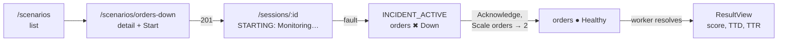

# Front plan

What `oncall-training-frontend` has built and the plan for the final delivery. Owner: JP.

Related: [Front decisions](https://github.com/Pardosito/oncall-training-frontend/blob/main/docs/DECISIONS.md) · [Roadmap](README.md) · [Back plan](back-plan.md) · [Infra plan](infra-plan.md)

---

## 1. The user flow today

`API_PROXY_TARGET=http://<alb-dns> VITE_AUTH_MODE=dev pnpm dev` on a demo machine whose IP is allowed by the ALB:

`pnpm dev:mocks` runs the same flow in the browser against MSW and a session simulator, with no backend and no AWS.

---

## 2. Built for the intermediate delivery

| Area | What it is |
|---|---|
| Tooling | Vite + React 19 + strict TypeScript, ESLint + Prettier, Vitest + Testing Library, CI (lint, typecheck, test, build) |
| Design system | IBM Carbon (g100 theme, Plex fonts) |
| API layer | Types generated from the backend's pinned `openapi.json`, one typed client (`fetch` is banned elsewhere by ESLint), `ApiError`, TanStack Query defaults |
| Mocks | MSW in the browser and in tests; a session simulator (fault after 10 s, recovery after the fix) |
| Auth | Dev auth behind one auth interface (`x-dev-user`); the Cognito implementation plugs into the same interface |
| Shell | Router with lazy routes, header and navigation, toasts, page header, empty/error/loading states |
| Scenarios | List, detail, start → `/sessions/:id` |
| Incident console | Session and dashboard polling (stops at a terminal state), service tiles, event timeline, timer, Acknowledge / Restart / Scale actions with error handling, result view with score, TTD and TTR |
| Against the backend | `API_PROXY_TARGET` for the Vite proxy; runs against the API on EKS |

---

## 3. Plan for the final delivery

| Work | What to build | Milestone |
|---|---|---|
| Cognito | OIDC config, `/callback`, token renewal on 401, sign-out, user menu, Bearer header | M2 |
| Busy notice | The 409 `SESSION_BUSY` notice with auto-retry, once the backend has the global lock | M2 |
| Production build | Config error screen, refuse dev auth in production builds, landing page; deploy to the S3 site bucket behind CloudFront | M2 |
| History, stats, leaderboard | Pages for `/api/me/sessions`, `/api/me/stats/*` (Carbon Charts) and `/api/leaderboard/{scenarioId}` | M3 |
| Logs and abandon | Logs viewer and abandon action (routes already in the spec) | M2 |
| Polish | Pod table, favicon and meta, 404 page | M4 |

---

## 4. Risks

| Risk | Impact | Mitigation |
|---|---|---|
| The spec changes after the frontend pins it | Type errors late in the week | Re-pin early; the backend is contract-first |
| Backend not reachable during a demo | No live run | `pnpm dev:mocks` shows the same screens |
| Demo machine IP changes | The ALB refuses the proxy | Check the IP the day before and re-apply `alb_ingress_cidrs` |
