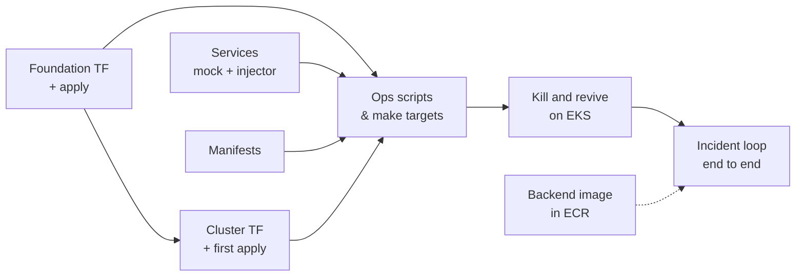

# Infra plan

What the infra repo has built, in the order it was built, and the plan for the final delivery.

Related: [Infra decisions](../DECISIONS.md) · [Roadmap](README.md) · [Back plan](back-plan.md) · [Front plan](front-plan.md)

---

## 1. Build order

The services and the manifests need no AWS (code, unit tests, `kubeconform`), so they were built while the 20-minute cluster applies ran. Everything billable was grouped into as few cluster sessions as possible.

---

## 2. Built for the intermediate delivery

### Foundation stack (always on)

| Piece | What it is | Notes |
|---|---|---|
| Scaffold + `make foundation-plan/-apply` | Same pattern as bootstrap: plan to a file, confirm, apply the saved plan | |
| S3 files bucket | `awscc_s3_bucket`, SSE-S3, public access block, `athena-results/` expires after 7 days | Must be `awscc` (D-24) |
| DynamoDB `Sessions` | On-demand, `user_id`/`session_id`, GSI `Leaderboard`, PITR, deletion protection | Names match backend ARCHITECTURE §7.1 |
| Module `queue-with-dlq` | Queue + DLQ + redrive, SSE-SQS; FIFO variant with content-based dedup off | |
| SQS `faults`, `user-actions.fifo` | Visibility 60 s, `maxReceiveCount = 3` | |
| ECR ×3 | Immutable tags, scan on push, keep the last 15 | Tags are git SHAs |

### Cluster stack (destroyed when idle)

| Piece | What it is | Notes |
|---|---|---|
| VPC | `10.20.0.0/16`, 2 public subnets, IGW, no NAT | Plain resources, no module (D-03, D-04) |
| EKS | LabRole, `authentication_mode = "API"`, one explicit access entry for the lab role | D-26 |
| Node group | 2× t3.medium On-Demand, AL2023 x86_64, IMDSv2 with hop limit 2 | Images are built for `linux/amd64` |
| Add-ons | `vpc-cni` (network policy enabled), `coredns`, `kube-proxy` | |
| AWS Load Balancer Controller | Helm release on the node role | |
| ALB security group | Port 80 from the demo machines' IPs only | CloudFront prefix list in M2 |

### Services (TypeScript, pnpm workspace, Vitest)

| Piece | What it is |
|---|---|
| Mock system | One image, `ROLE = gateway \| orders \| worker-svc`; `/ping` for probes, `/health` follows the chain, synthetic traffic and error logs |
| Injector | Long-polls `faults`, validates with zod, checks the session is `STARTING`, applies `SCALE_TO_ZERO` / `DELETE_PODS`, then marks the session `INCIDENT_ACTIVE`; idempotent by `faultId` |

### Kubernetes and operations

| Piece | What it is |
|---|---|
| Manifests | Namespaces `app`, `injector`, `mock`; ServiceAccounts; Roles in `mock` bound to the other namespaces (no ClusterRoles); Deployments and Services with probes, limits and a hardened security context; the Ingress |
| aws overlay | Image tags from `images.env` (committed), registry and ALB security group from `cluster.env` (generated), config from Terraform outputs (D-27) |
| `make` targets | `creds`, `bootstrap`, `cluster-up`, `cluster-down`, `images`, `deploy`, `status`, `check-rbac`, `render-config`, `k8s-validate` |

### Verified on EKS

1. `make cluster-up`, then the mock system and the injector run in their namespaces.
2. A FAULT sent by hand scales `orders` to 0 and the gateway's `/health` returns 503.
3. Scaling `orders` back to 2 makes the system healthy again.
4. With the backend deployed, the full loop runs from the SPA through the ALB: start `orders-down` → fault → `INCIDENT_ACTIVE` → scale `orders` → `RESOLVED` with a score.
5. `make cluster-down` removes the ALB first, then destroys the stack.

---

## 3. Plan for the final delivery

### M2 · Orchestration (Nov 19)

| Work | What to build | Notes |
|---|---|---|
| CI | `make lint` (fmt, validate, tflint, kubeconform, shellcheck, pnpm lint/test); `ci.yml` that runs it without AWS; a check that rejects IAM resources and `aws_s3_bucket` | First, so everything after it is checked |
| Step Functions | `statemachines/scenario.asl.json` (JSONata): Init → Warmup → InjectFault → WaitForFix (`AWAIT_FIX` + task token) → PersistResolved / MarkFailed → `SESSION_ENDED` | ARCHITECTURE §6. Verify the FIFO task-token call with TestState first (O-03) |
| ElastiCache | Valkey, one small node, private subnets, TLS; `REDIS_URL` back in the config | Cluster stack, billed hourly |
| Cognito | User pool, managed login domain, public PKCE client; e2e user by script | D-22 |
| CloudFront + S3 site | OAC to the site bucket, `/api/*` to the ALB, `spa-rewrite` Function; the ALB only accepts CloudFront's prefix list | `update-api-origin.sh` after each `cluster-up` (D-08) |
| NetworkPolicies | default-deny-ingress in the three namespaces, plus allow-alb-to-api, allow-intra-mock, allow-from-app | Applied together; check probes and ALB targets on EKS first (O-04) |
| kind | Local overlay and `make kind-up` with optional Calico | Develop without paying for EKS |

### M3 · Data + e2e (Nov 26)

| Work | What to build |
|---|---|
| Glue + Athena | Database `oncall_training`, table `session_events` with partition projection, workgroup with a 100 MB scan limit (D-21) |
| e2e | Happy path on the deployed stack through CloudFront with a Cognito user |

---

## 4. Risks

| Risk | Impact | Mitigation |
|---|---|---|
| Another Learner Lab restriction denies a call a provider makes (like D-24) | A stack fails mid-apply | Small applies early; probe with the CLI; `awscc` as an escape hatch |
| Cluster left up | ~$6/day of lab budget | `make cluster-down` at the end of every session |
| ARM images on x86 nodes | Pods crash with `exec format error` | `--platform linux/amd64` in `make images` |
| Lab credentials expire mid-apply | Half-applied state | `make creds` before each long apply; Terraform recovers on the next apply |
