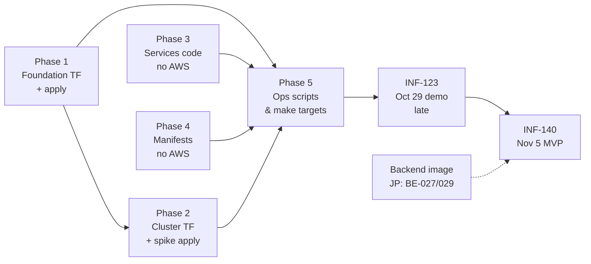

# M1 implementation plan (infra)

Plan for everything still missing in milestone **M1 · EKS up**, plus the 8 MVP issues that build on it, so the **Nov 5 MVP** is reachable. Written Fri Oct 30 for review.

Related: [Infra decisions](../DECISIONS.md) · [On-Call Training](README.md) (hub) · [Back plan (M1 + MVP)](back-plan.md) · [Front plan (M1 + MVP)](front-plan.md)

> [!WARNING]
> **Where we stand**
> - **M0 is done.** Repo tooling, `make creds`, `make bootstrap`; the state bucket exists and both `backend.hcl` files are generated.
> - **M1: 0 of 50 issues done.** No foundation or cluster Terraform, no manifests, no services yet.
> - **The Oct 29 deliverable (INF-123) was missed.** It folds into this plan and lands Tue Nov 3, two days before the MVP.
> - **Nov 5 MVP (INF-140)** needs all of M1 plus 8 MVP issues: #60, #65, #86, #99, #101, #138, #139, #140.
> - **The backend has no image yet.** Backend #27 (Dockerfile) and #29 (push to ECR) are open, so the backend Deployments can't run until JP ships them.

---

## 1. Critical path

**Phases 3 and 4 need no AWS** (code, unit tests, `kubeconform`), so they can fill the time while a 20-minute apply runs, or while the lab is down.

**Everything billable is grouped into as few cluster sessions as possible.**

---

## 2. Day-by-day schedule

| Day | Work | AWS? | Cluster up? |
|---|---|---|---|
| **Fri Oct 30** | Phase 0 (housekeeping). Phase 1: foundation code + `make foundation-apply`. Start Phase 3 (pnpm workspace). | yes (foundation, cheap) | no |
| **Sat Oct 31** | Phase 2: cluster code incl. the MVP pieces (LB controller, ALB SG). **Spike: first cluster apply**, find lab restrictions, destroy. | yes | **~2–3 h** |
| **Sun Nov 1** | Phase 3: mock system + injector with tests and Dockerfiles. | no | no |
| **Mon Nov 2** | Phase 4: all manifests + `k8s-validate`. Phase 5: render-config, images, cluster-up/down, status, deploy. | ECR push only | no |
| **Tue Nov 3** | First real `make cluster-up` → **INF-123 demo** (mock + injector, kill and revive). RBAC check. `cluster-down`. | yes | **~3 h** |
| **Wed Nov 4** | Integrate with JP's MVP backend/frontend; dry run of INF-140; fixes. | yes | **~3–4 h** |
| **Thu Nov 5** | **MVP demo**, then `make cluster-down`. | yes | demo only |

Cluster cost for the week: about 4 sessions × 3 h × $0.25/h ≈ **$3–4** (L-07).

---

## 3. Phase 0: housekeeping (Fri, ~1 h)

- [ ] **Commit the uncommitted MVP doc changes** in all three repos. Infra: AGENTS, README, ARCHITECTURE, BACKLOG, DECISIONS. Backend and frontend need **JP's review first**.
- [ ] **INF-124 (#124) · Ask the professor about O-02:** does the *injector* have to revive the service, or is the user's fix enough? A "yes" adds a `RESTORE_BASELINE` fault type. Ask today, since the answer can change the injector.
- [ ] Tell the professor the Oct 29 deliverable will be shown Tue Nov 3 (optional, your call).
- [ ] `make creds` at the start of every lab session.

---

## 4. Phase 1: foundation stack (Fri, ~4 h)

| Issue | What to build | Notes and gotchas |
|---|---|---|
| **#17** Foundation scaffold | Same files as bootstrap: `versions.tf` (aws + **awscc**, S3 backend), `providers.tf`, `variables.tf` (`owner`), `locals.tf` (`tags`, `awscc_tags`, caller identity, region, `data "aws_iam_role" "lab"`), `outputs.tf`, `terraform.tfvars.example` | Copy bootstrap's pattern for tags. `terraform init -backend-config=backend.hcl` (already generated) |
| **#18** `make foundation-plan` / `-apply` | Same shape as `make bootstrap`: `check-creds` → init → `plan -out=foundation.tfplan` → confirm → apply the saved plan | `*.tfplan` is already gitignored. Factor a small `tf_plan`/`tf_apply` macro, since cluster needs the same |
| **#19** Files bucket | `awscc_s3_bucket` `oncall-training-files-<acct>`: no versioning, SSE-S3, public access block, lifecycle rule `athena-results/` → expire 7 days, `prevent_destroy` | **Must be awscc (D-24).** Lifecycle goes in `lifecycle_configuration.rules` |
| **#20** DynamoDB `Sessions` | `aws_dynamodb_table`: `PAY_PER_REQUEST`, `user_id`/`session_id`, GSI `Leaderboard` (`scenario_id` S, `score` N, ALL), PITR, deletion protection, `prevent_destroy` | Contract with the backend: names must match backend ARCHITECTURE §7.1 exactly |
| **#21** Module `queue-with-dlq` | `terraform/modules/queue-with-dlq`: queue + DLQ + redrive, `sqs_managed_sse_enabled = true`; FIFO adds `.fifo` to both and keeps content-based dedup **off** | Outputs `url`, `arn`, `dlq_url`, `dlq_arn` |
| **#22** `faults` | Standard, visibility 60 s, retention 1 day, `maxReceiveCount = 3` | Output `faults_queue_url` |
| **#23** `user-actions.fifo` | FIFO, visibility 60 s, `maxReceiveCount = 3` | Output `user_actions_queue_url` |
| **#24** ECR | 3 repos, `IMMUTABLE`, scan on push, lifecycle keep 15 | Output `ecr_repository_urls` (map). Immutable means the same tag can't be pushed twice, so `make images` must use the git SHA |
| **#25** First apply | `make foundation-apply`; paste the plan summary in the issue; **send outputs to JP** (table name, queue URLs, ECR URL) for his CI | Watch for **another SCP surprise** (PITR, ECR scanning, SSE). If one appears, handle it like D-24: probe with the CLI, then make a decision entry |

---

## 5. Phase 2: cluster stack + spike (Sat, ~5 h incl. one apply)

Includes the MVP issues that live in the same stack (#60, #65, #138), so the cluster is applied once with everything.

| Issue | What to build | Notes and gotchas |
|---|---|---|
| **#50** Cluster scaffold | Standard files, S3 backend, `Stack=cluster` tags, LabRole data source, `terraform_remote_state "foundation"`, validated variables `node_instance_type`, `node_count`, `kubernetes_version` | **Remote state bucket name:** derive it from the account ID (`oncall-training-tfstate-${account_id}`) instead of adding a variable *(decision for review, §9)* |
| **#51** VPC + IGW | `10.20.0.0/16`, DNS hostnames/support, IGW | **Plain resources, no VPC module**, so no decision entry is needed |
| **#52** Public subnets | `10.20.0.0/20` (1a), `10.20.16.0/20` (1b), public IPs, tag `kubernetes.io/role/elb=1`, route `0.0.0.0/0 → IGW`, no NAT | |
| **#54** EKS cluster | `aws_eks_cluster` `oncall-training`, role LabRole, `authentication_mode = "API"`, public endpoint, logging off | **Version:** run `aws eks describe-cluster-versions --default-only` at spike time and set `kubernetes_version` to it. Check it's within ±1 of kubectl 1.36 |
| **#55** Access entry | Access entry + `AmazonEKSClusterAdminPolicy` for the `voclabs` role | **Conflict to resolve:** `bootstrap_cluster_creator_admin_permissions = true` (as ARCHITECTURE says) already creates an entry for the creator, which *is* the voclabs role, so a second entry fails "already exists". Proposal: set it to **`false`** and manage the entry explicitly. Get the role ARN with `data "aws_iam_session_context"` from the caller ARN (no hardcoding) *(decision for review, §9)* |
| **#56** Launch template | IMDSv2 required, hop limit 2, 20 GB gp3, `Name` tag | Don't set an AMI or instance type in the template (the node group sets them) |
| **#57** Node group | `default`: 2× t3.medium, `ON_DEMAND`, `AL2023_x86_64_STANDARD`, 2/2/3, LabRole, launch template | Nodes are **x86_64**, which matters for image builds (Phase 5) |
| **#58** Add-ons | `vpc-cni` (`enableNetworkPolicy: "true"`), `coredns`, `kube-proxy`; versions from `data "aws_eks_addon_version"` (default for the cluster version) | `resolve_conflicts_on_create = "OVERWRITE"`, since EKS installs self-managed versions first. `coredns` needs nodes (`depends_on` the node group) |
| **#138** ALB SG *(MVP)* | `oncall-training-alb`, inbound 80 from `var.alb_ingress_cidrs` (validation rejects `0.0.0.0/0`), output `alb_security_group_id` | Put your and JP's public IPs in a gitignored `*.auto.tfvars` (`curl ifconfig.me`) |
| **#60** LB controller *(MVP)* | `helm_release` of `eks/aws-load-balancer-controller` (chart pinned) in `kube-system`; `clusterName`, `region`, `vpcId` set; no service account annotation | Helm provider auth through `aws eks get-token` (exec) |
| **#64** Spike: first apply | `terraform apply`: nodes `Ready`, `kubectl get nodes` works, access entry survives `make creds` | **Time the apply.** Record any lab restriction in DECISIONS (answers part of O-01). **Destroy the same day** |
| **#65** Spike: LB controller *(MVP)* | Same session: controller pods running; a throwaway Ingress gets an ALB | If LabRole can't manage ELBs, use the D-07 fallback (NLB via `Service type: LoadBalancer`), which needs a decision entry |

> [!IMPORTANT]
> **The spike is the riskiest step**
> It answers O-01 (does EKS work with LabRole at all?). Do it as early as possible, even before the services are written. If it fails, everything else has to change.

---

## 6. Phase 3: services (Sun, ~6 h, no AWS)

| Issue | What to build | Notes |
|---|---|---|
| **#88** pnpm workspace | Root `package.json`, `pnpm-workspace.yaml` (`services/*`), `tsconfig.base.json` (strict, ESM, NodeNext), ESLint + Prettier, Vitest; scripts `lint`, `typecheck`, `test`, `build` | Copy what JP already set up in the backend (BE-002 to BE-006) for consistency |
| **#89** Mock scaffold | zod env (`ROLE`, `PORT=8080`), pino JSON, SIGTERM | Node's built-in `http` is enough; no framework needed for 3 routes |
| **#90** `/ping` | Always 200 + test | |
| **#91** `/health` chain | gateway → `orders /health` (800 ms), orders → `worker-svc /ping` (500 ms); 503 `{status:"down", reason}`, `latencyMs`; downstream URLs from env | Tests: success, connection refused, timeout per role. **Contract with the backend's health checks** |
| **#92** Synthetic traffic | gateway calls orders every 500 ms; `info` / `error` with cause | This is what the user sees in "view logs" |
| **#93** Mock Dockerfile | Multi-stage `node:22-alpine`, `USER node`, `.dockerignore`, works with a read-only root FS | |
| **#95** Injector scaffold | zod env, pino with `faultId`/`sessionId`, `/healthz`, SIGTERM stops polling | **`REDIS_URL` optional** (MVP #139) |
| **#96** FAULT schema | zod schema from ARCHITECTURE §7; target must be `mock` + `gateway\|orders\|worker-svc` | Tests: valid, malformed, wrong namespace, unknown deployment/type |
| **#97** k8s gateway | `scaleToZero`, `deletePods` by label selector, always namespaced | **Gotcha:** patching `deployments/scale` with `@kubernetes/client-node` needs the merge-patch content type set explicitly |
| **#98** SQS loop | Long poll 20 s; invalid messages are logged and **not** deleted (they go to the DLQ); delete after success; honors `AWS_ENDPOINT_URL` | Tests with a fake SQS client |
| **#99** Record step *(MVP)* | Conditional `UpdateItem` `STARTING → INCIDENT_ACTIVE`; `ConditionalCheckFailed` = already done | Cross-repo with the backend session item |
| **#101** Handler order *(MVP)* | Apply → record → delete; idempotent by `faultId` | Tests with fakes |
| **#102** Injector Dockerfile | Same as #93 | |

> [!NOTE]
> **Local testing without kind**
> kind moved to M2. For now: unit tests with fakes, plus `docker run` of the mock image (3 containers on one Docker network) to check the health chain by hand.

---

## 7. Phase 4: manifests (Mon morning, ~3 h, no AWS)

Follow CONVENTIONS §2: one resource per file `<kind>-<name>.yaml`, the 3 standard labels, requests + memory limit, both probes, full security context, `Recreate` for singletons, no wildcards in RBAC.

| Issue | What to build |
|---|---|
| **#68** Kustomize skeleton | `kustomization.yaml` in base (each area) and both overlays; `make k8s-validate` = `kustomize build … \| kubeconform -strict -summary` for both overlays |
| **#69** Namespaces | `app`, `injector`, `mock` |
| **#70** ServiceAccounts | `app/backend-api`, `app/backend-worker`, `injector/injector`; mock SA with `automountServiceAccountToken: false` |
| **#71–73** Roles + RoleBindings | All in `mock`, exactly ARCHITECTURE §5.2: `mock-reader` (api), `mock-operator` (worker), `mock-injector` (injector) |
| **#79–80** Mock Deployments + Services | gateway 1, orders 2, worker-svc 1; `ROLE` env; `/ping` probes; `50m`/`64Mi`; ClusterIP 8080 |
| **#81** Injector Deployment | ×1 `Recreate`, `/healthz`, `envFrom: oncall-config` |
| **#82–83** Backend api/worker | api ×2 (3000, `/healthz` + `/readyz`), worker ×1 `Recreate` (3001) |
| **#86** Ingress *(MVP)* | aws overlay only: `ingressClassName: alb`, internet-facing, IP targets, name `oncall-training-api`, `/healthz`, SG from config |

---

## 8. Phase 5: ops glue (Mon afternoon, ~4 h)

| Issue | What to build | Notes |
|---|---|---|
| **#84** `render-config.sh` | `terraform output -json` from both stacks → `k8s/overlays/aws/config.env` (gitignored); warns about missing outputs (Redis, Step Functions, Cognito before M2) | |
| **#139** MVP config *(MVP)* | Same script writes the MVP keys: `AUTH_MODE=dev`, `ALLOW_DEV_AUTH=true`, `ORCHESTRATION_MODE=direct`, `FAULTS_QUEUE_URL`; skips `REDIS_URL`, `STATE_MACHINE_ARN`, `COGNITO_*` | Removed in M2 |
| **#85** aws overlay | `images.env` (committed: `BACKEND_TAG`, `INJECTOR_TAG`, `MOCK_TAG`) → Kustomize `images:` with ECR URLs; `configMapGenerator oncall-config` in `app` + `injector` | |
| **#106** `make images` | ECR login, tag = short git SHA, refuses a dirty tree, prints the tags | **Build for `linux/amd64`** (`docker buildx build --platform linux/amd64`). Your Mac is ARM and the nodes are x86_64, so a plain `docker build` produces images that crash with `exec format error` |
| **#107** `make cluster-up` | confirm → `terraform apply` cluster → `aws eks update-kubeconfig` → `render-config` → `kustomize build \| kubectl apply` → cost reminder | `check-creds` first. Skip the CloudFront origin step until M2 |
| **#109** `make cluster-down` | Delete Ingress → poll until ALB `oncall-training-api` and the controller's SGs are gone (timeout) → `terraform destroy` → "foundation stays up" | **Most important target for the budget** (D-20). Test it on Tue before relying on it |
| **#110** `make status` | Nodes, pods per namespace, ALB DNS, image tags, "billing ~$0.25/h" | |
| **#111** `make deploy` | Update `images.env`, check each tag exists in ECR, re-apply, `rollout status` | |

---

## 9. Phase 6: deliverables (Tue–Thu)

**INF-074 (#74) · RBAC check:** `scripts/check-rbac.sh` with `kubectl auth can-i --as=system:serviceaccount:…`. It asserts both what's allowed and what's denied (the injector can't touch `app`; the api can't scale). Run it on EKS on Tue.

**INF-123 (#123) · Oct 29 deliverable (late, Tue Nov 3):**
1. `make cluster-up`
2. mock system + injector running in their namespaces
3. send a FAULT by hand (`aws sqs send-message` with the §7 JSON) → `orders` goes to 0 → gateway `/health` 503
4. `kubectl scale deploy/orders -n mock --replicas=2` → healthy again
5. write the demo steps down, then `make cluster-down`

The backend Deployments are included only if JP's image exists by then; otherwise their replicas stay at 0 *(decision for review)*.

**INF-140 · Nov 5 MVP:** with JP's MVP backend and frontend: `API_PROXY_TARGET=http://<alb-dns> VITE_AUTH_MODE=dev pnpm dev` → start `orders-down` → fault → `INCIDENT_ACTIVE` → scale orders → `RESOLVED` with a score → baseline restored → `make cluster-down`.

---

## 10. Decisions for your review

| # | Question | My recommendation |
|---|---|---|
| 1 | EKS access: ARCHITECTURE says `bootstrap_cluster_creator_admin_permissions = true` **and** an explicit voclabs entry, but those collide | Set it to `false` and keep only the explicit entry (via `aws_iam_session_context`). Update ARCHITECTURE §4 + add a D-entry |
| 2 | How the cluster stack finds the state bucket for `terraform_remote_state` | Compute it from the account ID; no variable, since the bucket name is deterministic |
| 3 | VPC: plain resources or the VPC module | Plain resources (4–6 resources, no decision entry, no IAM surprises) |
| 4 | Backend Deployments before JP's image exists | Ship the manifests, keep the backend at 0 replicas until an image tag exists in `images.env` |
| 5 | Image architecture | Always `linux/amd64` via buildx. Also tell JP for the backend's release workflow |
| 6 | Order: spike before services? | Yes: cluster spike on Sat, before writing services. It's the biggest unknown (O-01) |
| 7 | kind (moved to M2) | Don't do it now; test services with unit tests + Docker |
| 8 | Workload balance: infra has 58 issues to Nov 5 (50 M1 + 8 MVP), JP has 67 MVP issues plus his M1 | After Tue, consider taking frontend #125 and #34–36 (mock simulator) off JP's plate |

---

## 11. Risks

| Risk | Impact | Mitigation |
|---|---|---|
| EKS or the LB controller doesn't work with LabRole (O-01) | No cluster, or no ALB | Spike on Sat; NLB fallback (D-07) |
| Another SCP denies a call a provider makes (like D-24) | A stack fails mid-apply | Small applies early; probe with the CLI; `awscc` as an escape hatch |
| Backend image not ready | INF-123 and INF-140 without a backend | Infra demo uses mock + injector only; daily sync with JP |
| Cluster left up overnight | ~$6/day of lab budget | `make cluster-down` at the end of *every* session; test it on Tue |
| ARM images on x86 nodes | Pods crash (`exec format error`) | `--platform linux/amd64` in `make images` |
| Lab credentials expire mid-apply (~4 h sessions) | Half-applied state | `make creds` before each long apply; Terraform recovers on the next apply |

---

## 12. Issues that were in M1 and moved out on Oct 27

These 23 issues were originally part of M1. When the Nov 5 MVP was added (D-25), 5 moved **into the MVP** and 18 moved **to M2 (Nov 19)**. That's why they aren't in the M1 milestone on GitHub today. They're listed here so the plan accounts for the whole original M1.

### Moved into the MVP (covered above)

| Issue | Covered in |
|---|---|
| #60 LB controller, #65 LB controller spike | Phase 2 (§5) |
| #86 backend-api Ingress | Phase 4 (§7) |
| #99 injector record step, #101 apply-then-record order | Phase 3 (§6) |

### Moved to M2 (Nov 19), with a plan for each

**Week of Nov 9, before any Step Functions work.** Once the MVP is out, CI protects everything that follows.

| Issue | What to build | Notes |
|---|---|---|
| **#112** `make lint` | One target that runs `terraform fmt -check -recursive`, `validate` + `tflint` per stack, `make k8s-validate`, shellcheck on `scripts/`, `pnpm lint typecheck test` | CI calls this same target (D-19). Start with what exists; each later issue adds its check here |
| **#114** `ci.yml`: Terraform | Workflow on PR + push to `main`: setup via `jdx/mise-action` (same pinned versions), `terraform init -backend=false` + `validate` per stack, `tflint` | **Never needs AWS** (CONV §6). Pin actions by commit SHA |
| **#115** Forbidden resource check | `scripts/check-forbidden-iam.sh`: grep `terraform/**/*.tf` for every type in CONV §1.4 (IAM types, Pod Identity, **`aws_s3_bucket`**, D-24); called by `make lint` and CI | Match `resource "<type>"` exactly, so `aws_s3_bucket_policy` stays allowed |
| **#116** kustomize + kubeconform | `make k8s-validate` in CI for both overlays | `config.env` doesn't exist in CI: commit a `config.env.example` and copy it in CI, or the aws overlay won't build |
| **#117** pnpm lint/test + docker build | `pnpm install --frozen-lockfile`, lint, typecheck, test, `docker build` both services (no push) | Build for `linux/amd64` to match `make images` |
| **#118** shellcheck | Already a pre-commit hook; add a CI step (or let `make lint` cover it) | Cheapest one; can be merged into #112 |
| **#120** `images.yml` | On merge to `main` (paths `services/**`): AWS creds from the lab secrets → `make images` | Fails while the lab secrets are stale (L-06); the check-creds message explains it |
| **#8** CODEOWNERS + protect `main` | `CODEOWNERS` (infra → Ian; `k8s/base/app/` + contracts → Ian + JP); branch protection requiring `ci.yml` | Only after #114–#117 are green, or every PR is blocked |

**Week of Nov 9 (local development).** Useful once the MVP works, to iterate without paying for EKS.

| Issue | What to build | Notes |
|---|---|---|
| **#87** local overlay | `k8s/overlays/local`: local image names, `imagePullPolicy: Never`, no Ingress, config pointing at the backend's LocalStack (`AWS_ENDPOINT_URL=http://host.docker.internal:4566`) | ARCHITECTURE §14 |
| **#103** `scripts/kind-up.sh` | kind cluster `oncall-training`; `CALICO=1` installs Calico so NetworkPolicies are enforced | kind 0.33 is already pinned in mise |
| **#104** `make kind-up` / `kind-down` | Build both images (native arch is fine locally), `kind load docker-image`, `kustomize build overlays/local \| kubectl apply` | |
| **#105** Local smoke test | On kind: send a FAULT to LocalStack SQS → `orders` goes to 0 → scale back → healthy | Same steps as INF-123, but free |

**With the M2 security work (after Step Functions, before Nov 19):**

| Issue | What to build | Notes |
|---|---|---|
| **#59** ALB SG restricted to CloudFront | Replace the MVP's IP list (#138) with the managed prefix list `com.amazonaws.global.cloudfront.origin-facing` | Needs CloudFront (INF-026–030) first |
| **#67** Spike O-04 | On EKS with the policies applied: do kubelet probes and ALB IP targets still work? | Run in the same cluster session as #75–78 |
| **#75** default-deny-ingress | In `app`, `injector`, `mock` | Apply together with #76–78, or the ALB and health checks break |
| **#76** allow-alb-to-api | Ingress to `backend-api:3000` from the VPC CIDR | |
| **#77** allow-intra-mock | Between mock pods on 8080 | |
| **#78** allow-from-app | From namespace `app` to mock pods on 8080 | The backend's health checks and logs depend on it |

> [!NOTE]
> **Why these could wait**
> None of them is needed to show the incident loop. CI and kind make development safer and cheaper; NetworkPolicies and the CloudFront-only ALB are security hardening, and the course requires them for the final delivery, not for the MVP. The risk of postponing CI is regressions during the MVP week, which the pre-commit hooks partly cover.
